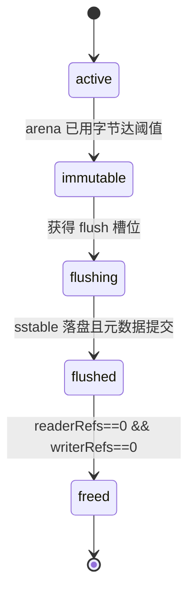

# CairnKV 设计决策书（基于研究循环 20 条迭代）

> **读者**：CairnKV 的实现者。你手上有草案 `docs/cairnkv-design-overview-go.md`（v0.1，55 条 `B-xx`）与
> 本轮研究产出的 19 份论证文档（`.autoresearch/work/iter-NN-*.md`）。本文档把每一项决策**钉到可实现的程度**：
> 最终定了什么、候选方案与证据是什么、代价是什么、相对草案是保留/修正/推翻/defer、还有哪些没定。
>
> **本文档只从既有研究工件取材**，不引入新检索结论。凡裁决记录
> `.autoresearch/work/iter-20-arbitration.md` 裁决过的项，正文一律写裁决结论，不再并列两种立场。

---

## 0. 阅读指南

### 0.1 本决策书的权威优先级

当本文档与来源冲突时，以优先级高者为准（与任务书一致）：

1. **`.autoresearch/work/iter-20-arbitration.md`（主代理裁决记录）** —— 最终裁决。凡裁决过的项不得照抄某个 lane 的原始建议。
2. `autoresearch.jsonl`（20 条机器可读记录：`decision` + 六维评分 + `one_line`）。
3. 5 份 `block-*-digest.md`（lane 摘要）。
4. `.autoresearch/work/iter-NN-*.md`（19 份详细论证，取细节与证据标识符）。
5. `baseline.md`（55 条基线决策原文）。

**附加说明（本文档发现、裁决记录未显式处理的不一致）**：裁决记录与 lane 工件在**参数命名**上不完全一致
（详见 §0.4 末的"命名不一致"小节）。本文档以**裁决记录的命名为权威**，并在相应章节标注 lane 侧的旧名。

### 0.2 决策处置的四种类型（keep / 修正 / 推翻 / defer）

本文档每一项决策的"相对草案 v0.1"字段取值，定义如下：

- **保留（keep）**：草案的明确决策在研究中被确认成立，只做非语义的澄清。
- **修正**：草案方向正确，但表述、机制或参数被精确化/替换（含对草案措辞歧义的消解）。
- **推翻**：研究成果与草案的明确决策方向相反，且该决策不是硬约束。
- **defer**：第一期不实现或不定论，显式保留接口/触发条件。

> 注：机器可读记录 `autoresearch.jsonl` 的 `decision` 字段另有一套取值
> `adopt / keep / defer / reject`（用于迭代级聚合），与上面的"相对草案"处置不是同一坐标系。
> 一条 `adopt` 的迭代可能相对草案是"修正"或"推翻"。

### 0.3 六维评分口径与硬门槛

评分是**相对基线（草案 v0.1，基线自身记 3 分）的比较级**，取 1–5 整数：

| 维度 | 方向 | 1 分 | 3 分 | 5 分 |
|---|---|---|---|---|
| `wa` 写放大 | ↑ 越高越优 | 显著更差 | 与基线相当 | 显著更优 |
| `ra` 读放大 | ↑ 越高越优 | 显著更差 | 与基线相当 | 显著更优 |
| `sa` 空间放大 | ↑ 越高越优 | 显著更差 | 与基线相当 | 显著更优 |
| `lat` 延迟/前台停顿 | ↑ 越高越优 | 显著更差 | 与基线相当 | 显著更优 |
| `cx` 实现复杂度 | ↓ 越低越好 | 极简 | 与基线相当 | 极复杂 |
| `risk` 风险/不确定性 | ↓ 越低越好 | 风险很低 | 与基线相当 | 风险很高 |

**硬门槛**（`hard_gate`，三键 `dup / crc / fmt`，取 `pass / fail / na`）：

- `dup`（持久化语义）：不破坏草案 §4.1——逐次同步档确认返回前已 fsync；分组同步档确认发生在批量同步之后。
- `crc`（崩溃一致性）：崩溃后状态可重建——半截 WAL、未登记残留文件、损坏块都能被检测并明确报错。
- `fmt`（格式兼容性）：带魔数与版本号；升级有明确迁移或拒绝打开策略；比较器变更可校验。

**规则**：任何 `hard_gate` 有 `fail` 的方案一律 `reject`/`defer`。
**评分校准规则**：缺少权威先例、强平台依赖、难以验证的方案，`risk` 必须 ≥ 4。

### 0.4 决策总账（20 条迭代一览表）

下表对应 `autoresearch.jsonl` 的 20 条记录（iter 0 为基线）。评分栏顺序为 `wa/ra/sa/lat/cx/risk`。

| iter | slug | decision | wa/ra/sa/lat/cx/risk | one_line |
|---|---|---|---|---|
| 0 | `baseline` | baseline | 3/3/3/3/3/3 | 基线 = 草案 v0.1 的 55 条默认决策，其中 13 条 UNSPEC 是研究的重点靶区。 |
| 1 | `amplification-and-rum` | adopt | 4/4/4/3/3/2 | 字节级口径：`write_amp=(WAL+flush+compact)/用户字节`；RA 给文件数与字节两个口径；SA 须含 obsolete。 |
| 2 | `cost-model-and-tuning` | adopt | 4/4/3/3/4/3 | 合并策略只暴露 12 个静态参数（T、BaseLevelSize、双 L0 阈值、块/缓存/过滤器/同步）；自适应 defer。 |
| 3 | `industrial-matrix` | adopt | 3/4/3/3/4/3 | 以 Pebble 为主要参照：继承 9 项、放弃 6 项（blob/virtual sstable/colblk）、现代化 5 项。 |
| 4 | `go-constraints-vfs` | adopt | 3/3/3/3/4/4 | vfs 取 12+11 方法（含 SyncTo/SyncData/OpenDir/Lock）；第一期不做 mmap；fsync 失败按致命。 |
| 5 | `wal-record-format` | adopt | 3/4/3/3/3/2 | 采纳 32KiB 分块日志＋7 字节头＋4 类片段＋masked CRC32C；块边界重对齐消除扁平日志的静默截断风险。 |
| 6 | `sync-modes-groupcommit` | adopt | 3/3/3/5/4/4 | 同步档位改为三档、组提交作默认；批次只受字节与等待者上限约束而不用可调定时器；fsync 失败必须致命化。 |
| 7 | `memtable-structure` | keep | 3/3/3/4/3/2 | 确认跳表为默认内存表，形态定为 arena＋32 位偏移＋p=1/e＋20 层；ART 因约 5 次堆分配/键与 GC/硬上限冲突而否决。 |
| 8 | `memtable-memory-concurrency` | adopt | 3/3/3/4/4/4 | 内存表用 Go 堆内 []byte arena 按需倍增＋单回收槽位；冻结用五状态机＋双引用计数；不用 cgo 以保留 -race 覆盖。 |
| 9 | `internal-key-mvcc` | adopt | 3/3/3/3/3/3 | 内部键定为 user_key‖(seq<<8)\|kind、排序为用户键升序＋trailer 降序；批次靠可见性水位保原子性；序号耗尽则拒绝写不回绕。 |
| 10 | `sstable-block-format` | adopt | 3/3/4/3/4/2 | 行式块格式 + 4KB 块 + 53 字节带格式版本 footer + 专属魔数；列式块第一期否决并预留版本位。 |
| 11 | `filter-selection` | adopt | 3/4/3/3/3/2 | 文件级缓存行分块 Bloom、10 bits/key（FPR≈1%）、family 化接口；Ribbon/Binary Fuse/分区过滤器 defer。 |
| 12 | `read-path-index` | adopt | 3/4/3/4/4/3 | 步骤级点查算法（一层一次二分查、命中即停）+ 索引/过滤器独立缓存池；learned index 对块索引 reject。 |
| 13 | `block-cache-policy` | adopt | 3/4/3/4/4/3 | 分片 CLOCK-Pro + 索引/过滤器高优先级池 + 扫描旁路 + 三笔内存预算；mmap 第一期不用但给出 EXP-13-MMAP 协议。 |
| 14 | `block-compression` | adopt | 3/3/4/3/3/2 | 默认开启块级 Snappy（12% 阈值）+ 不压缩索引/过滤器 + 主缓存存解压块；字典压缩与压缩块二级缓存 defer。 |
| 15 | `manifest-versioning` | adopt | 3/3/4/4/4/2 | Manifest 采用 VersionEdit 追加日志 + 全量快照首记录 + 编辑数驱动滚动；CURRENT 改用标记文件；目录 fsync 必做。 |
| 16 | `compaction-strategy` | adopt | 2/5/4/5/4/2 | 裁决 B-33/B-37 矛盾：第一期默认改为 leveled，size-tiered 与 hybrid 均 defer；代价是约 2.7× 写放大。 |
| 17 | `compaction-scheduling-backpressure` | adopt | 3/4/3/5/4/4 | 采纳三条件两档背压（L0 slowdown=8 / stop=12、内存表上限=2）+ 三级优先级调度；限速默认关闭；抢占 defer。 |
| 18 | `tombstone-gc-space-amp` | adopt | 3/4/4/3/3/4 | 裁决 B-39/B-40：安全条件=更深层无更旧版本∧无活跃快照；范围删除与 TTL 原语 defer；SA 需配墓碑密度指标。 |
| 19 | `correctness-verification` | adopt | 3/3/3/3/4/4 | vfs 层统一故障注入 + 有序模型对拍为第一期必做，蜕变测试骨架推迟到 M3，CI 分 PR 门禁与 nightly 两级。 |

> iter 19 的 `risk` 由 3 上调为 4（裁决-20，见 §15）。上表已按更新后的 `autoresearch.jsonl` 取值。
> iter 20 不是迭代记录，而是主代理的**裁决记录**（`.autoresearch/work/iter-20-arbitration.md`）。

**命名不一致（本文档发现，裁决记录未显式裁决）**：同一参数在裁决记录与 lane 工件间有多个名字，尚无唯一权威命名：

| 概念 | 裁决记录用名 | lane 工件用名 | 出处 |
|---|---|---|---|
| memtable 队列上限 | `MemTableCountLimit`（裁决-09/19） | `MemTableStopWritesThreshold`（iter-08/17）、`MemTableStopWritesThreshold=2`（裁决记录 UNSPEC 表亦混用） | iter-20、iter-08、iter-17 |
| 层大小比 `T` | `LevelMultiplier`（裁决-09）、`T`（iter-02） | `SizeRatio`（iter-16） | iter-20、iter-16 |
| 基础层字节 | `BaseLevelSize`（裁决-09） | `LevelBaseBytes`（iter-16） | iter-20、iter-16 |
| L0 合并触发 | `L0CompactionThreshold`（裁决-09） | `L0CompactionTrigger`（iter-02 混用） | iter-20、iter-02 |
| L0 慢写阈值 | `L0SlowdownWritesTrigger`（裁决-19/UNSPEC 表） | 未列入 `Options.Tuning` 表（裁决-09 遗漏） | iter-20 |

**实现建议**：M1 开始前由作者选定一套唯一命名并写入 `options.go`，本文档以下统一采用**裁决记录侧的命名**。

---

## 1. 全局结论

### 1.1 20 条迭代的决策分布与汇总统计

- **迭代级 decision**：`autoresearch.jsonl` 的 iter 1–19 中，**`adopt` 18 条**、**`keep` 1 条**（iter 7 内存表结构）、无 `defer`、无 `reject`。
- **子条目级**：iter 18 内部的 compaction filter 判定为 **`reject`**（这是全循环唯一的子条目级否决）。
- **硬门槛**：iter 1–19 的 `dup / crc / fmt` **全部 `pass`**。但 iter 5/6/7/8/9 的 `pass` 是**条件性 pass**——
  条件是不变量 R1/R2/R3 被实现并被测试（见 §2.3、§3.3、§3.4 与 §1.3 的 V-02）。
- **评分极值**：
  - `wa` 最低 = **2**（iter 16，leveled 的写放大代价）。
  - `ra` / `lat` 最高 = **5**（iter 16 的 `ra=5`；iter 6/16/17 的 `lat=5`）。
  - `risk` 最高 = **4**：iter 4、6、8、17、18、19。
  - `cx` 最高 = **4**：iter 2、3、4、8、10、12、13、15、16、17、19。
- **UNSPEC 消解**：草案的 13 条 `UNSPEC` **全部消解**（13/13，覆盖率 100%），另 2 条"决策已定但执行细节欠明确"
  条目（`B-22` mmap、`B-54` 对照实验）也被处理（裁决记录第二部分）。
- **草案差异**：A 类措辞澄清 9 项、B 类实质修正 10 项、C 类需求优先级变更建议 3 项（见 §16）。
- **必须补做的验证**：12 项（V-01…V-12，见 §1.3）。
- **未核验项**：15 项（U-1…U-15，见 §1.4），**不得写成事实**。

### 1.2 收益归因表（RA 分项拆分 —— 按裁决-14，分项不叠加）

裁决-14 的裁决理由：iter-12 的 `ra=4` 与 iter-16 的 `ra=5`**可能把同一份收益计两次**——
"L0 重叠文件数的下降"既被归给合并策略，又被算进读路径改善。因此汇总结论必须用下表拆分：

| RA 分项 | 归因 | 由谁改善 |
|---|---|---|
| `|{重叠的 L0 文件}|` | **合并/调度项** | iter-16（leveled 让 L0 快速下落）+ iter-17（L0 触发与停顿阈值） |
| `|{有文件的层数}|` | **合并项**（层形状） | iter-16（`LevelMultiplier` / `DynamicBaseLevel`） |
| `未命中的索引块读` | **读路径项** | iter-12（pin 顶层索引、两级索引） |
| `过滤器假阳性导致的无效块读` | **过滤器项** | iter-11（10 bits/key、整文件粒度） |
| `缓存未命中导致的重读` | **缓存项** | iter-13（CLOCK-Pro、扫描旁路） |

> **裁决-14 明确要求：这四个分项不叠加。** 汇总表不得把两处 `ra` 收益相加。
> 说明：裁决记录的表格实际列出 **5 行**（把 L0 文件数与层形状分列为两项）；任务书措辞为"四个分项"。
> 本决策书以**裁决记录表格为准**（5 行），但叠加规则（不叠加）不变。
>
> 另据 §10.5 的分歧（Block D 分歧 4）：iter 16 的 `wa=2` 与 iter 16 的 `ra=5`/`lat=5`、iter 17 的 `lat=5`、
> iter 18 的 `sa=4` 是**同一组取舍的两端**，聚合时不得当作互相独立的收益。

底层口径（iter 1，`B-53`）：`write_amp = (WAL + flush + compact 写字节) / 用户字节`；
RA 给"文件数"与"字节数"双口径；SA 须含 obsolete（不可回收但仍占空间）字节。
`ReadAmpBytes` 的采集边界（压缩后 vs 解压后字节）**未定**（V-12）。

### 1.3 必须补做的验证（12 项，按风险排序）

这些不是"以后再优化"，而是**在写第一行实现代码之前或同时必须闭环**的项。交付文档 03（实现计划）
会把它们排进里程碑；下表只做摘要与指向。

| # | 项 | 为什么必须先做 | 验证方式 | 归属 |
|---|---|---|---|---|
| **V-01** | 合并输入迭代器的**全序保证** | iter-09 版本丢弃规则依赖"同一用户键的版本连续且序号降序"；乱序会**丢掉正确的版本且不报错**（静默数据错误，本循环最高风险点） | 合并前断言输入严格符合 `InternalCompare` 全序；`test/model` 用"同一键跨 3 个 L0 文件写 3 个版本 + 一个活跃快照"对拍 | M3 之前 |
| **V-02** | `writerRefs` / R1 / R2 / R3 三条不变量 | `dup=pass` 是**条件性**的，条件是这三条不变量被实现并测试（裁决-02） | `test/model` 各一个定点用例 | M1 |
| **V-03** | 分组提交的**可观测性**（裁决-21 D6） | 否则 `dup` 在分组同步档只能做弱断言 | 同步策略暴露可订阅的提交事件（组内序号区间 + fsync 完成时刻，形态参考 Pebble `EventListener`） | M1 |
| **V-04** | fsync 失败的**毒化状态机**（裁决-06） | 这是 `dup` 的最后一道防线，且是相对 Pebble 的有意偏离，无现成先例可抄 | `test/crash` 用 `vfs/errorfs` 注入一次 fsync 失败，断言后续所有操作返回 `ErrEnginePoisoned` | M1 |
| **V-05** | 合并策略的写放大倍数 | iter-16 的"约 2.7×"是 **Sarkar PVLDB 2021 在 RocksDB、T=10、128 B entry 下**的实测，与 CairnKV 不同；这是 `wa=2` 的唯一实证依据 | `test/bench` 重测 | M3 |
| **V-06** | `MemTableSize=4MB` / `StopWritesThreshold=2` / 32 KiB WAL 块 / `(p, maxHeight)` 的最优性 | 全部是"从众取值"，无独立论证；且 memtable 越大 ⇒ WAL 越长 ⇒ 恢复越慢 | `test/bench` 扫参数网格，与恢复耗时实验合并 | M3 |
| **V-07** | `GOMEMLIMIT` 与硬上限的配比 | lane B 的"hard caps 之和 < GOMEMLIMIT × 0.8"是启发式；Go 官方警告误用会 thrashing | 同时记录 `runtime.MemStats` 与 GC 周期数，观察是否 thrashing | M3 |
| **V-08** | 恢复时 `logSeqNum` 的重建公式 | lane B **推断**为"所有已重放记录的最大 base+count + 1"，但**没找到** Pebble/LevelDB 里那段代码逐行确认 | `test/crash`：写入 → 崩溃 → 重启 → 再写入 → 断言新序号严格大于崩溃前所有已重放记录的序号 | M1 |
| **V-09** | 真实文件系统上的崩溃一致性 | 崩溃克隆假设目录 fsync 有效；**CI 全绿 ≠ ext4/xfs/btrfs 上正确**（裁决-20 的 `risk=4` 就因为这条） | 非 CI 的 `dm-log-writes` / `dm-flakey` job；写入 `docs/durability.md` 的已知局限 | M5 |
| **V-10** | darwin 上 `File.Sync` = `F_FULLFSYNC` 的**实现细节**（含 `ENOTSUP` 回退） | 依赖 Go 运行时的行为，未在 vfs 层验证；网络挂载上是真实风险 | vfs 层的平台测试 + 文档声明 | M1 |
| **V-11** | L0 子层的点查 RA 量化收益 | **iter-22 已核验：上游与学术侧均无可引用的量化数字**（详见 `work/iter-22-l0-sublevels-quantification.md` 的检索日志）；故该 defer 是**证据缺口型**（未量化），且已在 §17 / `DELIVERABLE-03` §11 显式标注 | 当 bench 观察到"**同一键上互相重叠的 L0 文件数（子层高度）经常 > 8**"时，升级为独立研究条目；升级后第一件事是量 CairnKV 自己的重叠文件数分布（均匀随机写 / 单调追加写 / zipf 三组） | M4 触发条件 |
| **V-12** | `ReadAmpBytes` 的采集边界（压缩后 vs 解压后字节） | iter-01 未定；影响 WA/RA 口径的自洽 | 两个都采，由 vfs 中间件实现 | M2 |

### 1.4 未核验项清单（**仍开放 5 项**；补充轮 iter 21–25 已关闭 10 项，**均不得写成事实**）

> **补充轮更新（2026-09-29）**：iter 21–25 收口了其中 10 项（U-1/U-2/U-3/U-4/U-5/U-6/U-9/U-10/U-12/U-14）；主轮 verifier 先已关闭 U-6。
> 以下只列**仍开放**的 5 项；已关闭项的结论与标识符见 `.autoresearch/work/iter-20-arbitration.md` 第五部分 B 节与各迭代工件。

| # | 未核验项 | 标注 |
|---|---|---|
| U-7 | 32 KiB WAL 块大小在 2026 年是否仍最优 | 无一手证据（进 V-06 扫描） |
| U-8 | `arenaskl` README 的 benchmark 数字（8 线程 470 ns/op 等） | 仓库自报告，未独立复现 |
| U-11 | `SeqNumStart = 10` 保留区的用途 | Pebble 只说 "1-9 reserved"，未说明用途 |
| U-13 | 墓碑密度阈值收敛值（Pebble RFC 写 5%，代码默认 0.10） | 上游未收敛 |
| U-15 | 目录 fsync 在 overlayfs / tmpfs / NFS 上的行为 | 未测（Pillai OSDI 2014 只覆盖 ext2/3/4、reiserfs、btrfs、xfs） |

> **补充轮关闭的 10 项（一句话结论；完整标识符见仲裁记录第五部分 B 节）**：
> U-1 有出处（Pugh CACM 1990 Table 1，`DOI:10.1145/78973.78977`，口径限定为最小化 `L(n)/p`，Pugh 本人推荐 1/4）；
> U-2 四方 CRC mask 逐位一致；U-3 无官方明文、机制可推出（P 不被交出去）；U-4 Moirai/LSM-forest 不存在、
> 自适应 defer 理由改「有依据的 defer」；U-5 DeWitt 1984 **不是**首提（自称 folklore）；U-6 `InternalKeyKindInvalid = 191`；
> U-9 CockroachDB 一手 URL 已找到；U-10 RocksDB arena/`block_size` 已核验；U-12 minlz 许可/架构/构建已核验（仍不作默认）；
> U-14 上游确有 MANIFEST 滚动公式（单位为表数，仅作 128 MB 体积门的附加否决位）。

---

## 2. 写路径

### 2.1 WAL 记录格式（B-05 / B-10）

**结论**：WAL 采用 **LevelDB 风格物理分块日志 + 现代加固**，分两层：

- **物理分块层**：固定 **32 KiB** 块；块头 **7 字节** = `maskedCRC32C(4B LE) | length(2B LE) | type(1B)`；
  4 类片段 `FULL / FIRST / MIDDLE / LAST`；**记录绝不跨块**；块尾剩余 < 7B 全零填充；恰好剩 7B 时发零 payload 的 `FIRST`；
  CRC 覆盖 `type + payload`，**不覆盖** `length`；**块边界天然 32 KiB 对齐**（满足未来 O_DIRECT 的扇区对齐需求）。
- **逻辑记录层**：批次头 `seq:uint64 LE + count:uint32 LE` + tagged 条目。
- **文件头**：`magic(8B) + formatVersion(uint16) + blockSize(uint32)`；读端**校验 `blockSize` 而不硬编码 32768**
  （这一点**刻意偏离 LevelDB**——原版 WAL 没有魔数，只能靠文件名与 MANIFEST 判断归属）。

**候选方案**：

1. **LevelDB 物理分块 + 现代修正（采纳）**。
2. 扁平日志 + 逐记录长度前缀 + CRC（无固定块边界）——被否决：块边界重对齐能消除"静默截断"风险。
3. Pebble `record` 包的多线格式（最强加固版）——偏重，第一期不取。
4. （对照）Badger 的 value log——不采用独立 WAL 目录。

**证据**：

- LevelDB 规范级文档 `leveldb/doc/log_format.md` @ `7ee830d`（`.autoresearch/third_party/leveldb/doc/log_format.md`）。
- `leveldb/db/log_reader.cc:99,115,195-258` @ `7ee830d`（九类损坏判定与 `if (!eof_) ReportCorruption(...)`）。
- `leveldb/db/log_format.h:16-30` @ `7ee830d`；`leveldb/util/crc32c.h:22,29,35` @ `7ee830d`。
- `pebble/record/log_writer.go:1000-1006,1023-1032,1058,1096` @ `e0818dd`；`pebble/internal/crc/crc.go:40-41` @ `e0818dd`。
- `goleveldb/leveldb/journal/journal.go:92-100,190,209,215` @ `126854a`（**上游已停滞，仅作格式一致性佐证**）。
- `badger/structs.go:55-96` @ `5688f14`。
- RocksDB WAL File Format：`https://github.com/facebook/rocksdb/wiki/Write-Ahead-Log-File-Format`。
- 论文（仅存在性）：Rebello et al., *Can Applications Recover from fsync Failures?*, ACM TOS 2021, `DOI:10.1145/3450338`。

**代价**：`cx=3`。新增"片段类型标志"字段与块尾填充逻辑；`crc` 门槛的机制主项就在这里。`ra=4`
来自块边界对齐对顺序读的改善（相对扁平日志）。

**相对草案 v0.1**：**修正**。`B-05` 的字段集合"**充分但不足够**"——缺"片段类型标志"；`B-10` 的
`UNSPEC`（是否分块/块大小/对齐）被消解为上述具体格式。

**开放的项**：32 KiB 最优性无一手证据（U-7、V-06）；~~RocksDB CRC mask 常量未核验（U-2）~~ **U-2 已关闭（iter 24）：mask 旋移与常数在 LevelDB / Pebble / goleveldb / RocksDB 四方逐位一致（`rocksdb/util/crc32c.h:37,44-53 @ 7510773`），WAL 块常量亦一致（32768 / 7 B 头）**；
Badger 是否完全没有独立 WAL 目录（由目录列表推断，unverified）；块尾零填充与 O_DIRECT 的交互未验证。

### 2.2 同步档位与确认点（B-04 / B-06 / B-44）

**结论**：

- 同步档位从两档改为**三档同步谱**：`SyncAlways`（逐次同步）/ `SyncGroupCommit`（**默认**）/ `NoSync`
  （显式 opt-in，**名称不得宣称持久性**）。
- **确认点**精确化为："从 `Set/Delete/Commit` 返回时，包含该批次的组提交所执行的那一次 fsync 已成功返回。"
- **`B-44` 落成机械规则**：**durability 需求只能保留或加强，不能稀释**——绝不把"要求 fsync"的写入者
  并入"不要求 fsync"的组。
- 批次**只受字节与等待者上限约束，不用可调定时器**。

**候选方案**：

1. 两档（草案基线）。
2. 三档同步谱（采纳）。
3. Pebble 的 `noSyncWait`（异步等 fsync）+ `Batch.SyncWait()`——**裁决-05：`defer`，不进第一期**。

**证据**：

- `pebble/commit.go:298,347-353`（`Commit(b, syncWAL, noSyncWait)`）、`:441-453`（`b.commit.Add(2)` 的 publish + WAL fsync）@ `e0818dd`。
- `leveldb/db/db_impl.cc:1303-1306` @ `7ee830d`：`if (w->sync && !first->sync) break;`（durability 不被稀释的全部秘密）。
- Badger `SyncWrites` 默认 false（第三档的真实工业先例）@ `5688f14`。
- PostgreSQL 官方 wiki：`https://wiki.postgresql.org/wiki/Fsync_Errors`（逐平台 fsync 失败语义）。
- Rebello et al., ATC 2020 / ACM TOS 2021，`DOI:10.1145/3450338`，PDF `https://www.usenix.org/system/files/atc20-rebello.pdf`。

**代价**：`lat=5`（组提交相对逐次同步显著降低前台等待），`risk=4`（组提交的确认点必须在崩溃测试下验证），
`cx=4`（三档 + 机械规则 + 组提交事件）。第 3 档 `NoSync` 把持久性责任显式交给调用者。

**相对草案 v0.1**：**修正**。`B-06` 两档 → 三档；`B-04` 的确认点被精确化；`B-44` 从原则变成机械规则。
裁决-05 追加：`noSyncWait` `defer`。

**开放的项**：**裁决-21 D6** 要求同步策略暴露"可订阅的提交事件"（组内序号区间 + fsync 完成时刻），
否则分组档 `dup` 只能做弱断言（V-03，M1）。DeWitt 1984 只作为 group commit 的**早期书面描述**引用（该文自称此想法属「未写下的民间传说」，**不是首提**；U-5 已收口，见 iter-25）。

### 2.3 WAL 恢复与损坏判定（B-07）

**结论**：恢复时把损坏拆成两类——

- **只有文件尾**的 header/payload 不完整才允许**静默截断**；
- **文件中部的任何不完整或 CRC 失败必须报 `Corruption`**。

给出 **9 条逐场景判定表**（见 `.autoresearch/work/iter-05-wal-record-format.md`）。

**候选方案**：① 一律静默截断（草案字面）；② 尾部截断 + 中部报错（采纳）；③ 一律报错（过严，会把正常掉电当损坏）。

**证据**：`leveldb/db/log_reader.cc:99,115,195-258` @ `7ee830d`（`if (!eof_) ReportCorruption(...)` 分支与
"写者写到一半死了"注释）；`leveldb/doc/log_format.md`（"tail 可短于一个块"）。

**代价**：`cx` 略增（判定表）；`crc` 门槛的主项。

**相对草案 v0.1**：**修正**（A 类澄清 A-2）。草案只说"忽略末尾不完整或校验失败的记录"，未区分中部与尾部。

**开放的项**：9 条场景需由 `test/crash` 覆盖，**必须包含**"文件中部单字节翻转"这一非尾部损坏用例
（这是唯一能区分正确实现与静默截断实现的测试）。

### 2.4 内部键与序号（B-02）

**结论**：内部键**逐字节布局**为 `user_key ‖ uint64 LE (seqNum<<8 | kind)`：

- `seqNum` **56 位**，值域 `[10, 2^56-1]`（采纳 Pebble 的 `SeqNumStart=10`，1–9 保留）。
- `kind` 8 位：**`0=Invalid / 1=Set / 2=Delete`**，`3..15` 预留（见裁决-04、§4.5）。
- **排序**：用户键升序 + **trailer 降序**（trailer 降序是**格式常量**，改了即格式版本升级）。

**候选方案**：

1. LevelDB 取值 `0=Delete / 1=Value`。
2. lane B 方案 `0=Invalid / 1=Set / 2=Delete`（**采纳**）。
3. 与 LevelDB 二进制兼容——**明确放弃**。

**证据**：`leveldb/db/dbformat.h:63-67` @ `7ee830d`（"We leave eight bits empty at the bottom"）；
`pebble/internal/base/internal.go:36-51,275-330` @ `e0818dd`；`pebble/internal/base/internal.go:431-437` @ `e0818dd`
（`InternalCompare` 的 `Reverse order for trailer comparison`）；`leveldb/db/version_set.cc:914-919` @ `7ee830d`。

**代价**：`cx=3`。与"顺手沿用 LevelDB 取值"的潜在冲突被显式消解。

**相对草案 v0.1**：**修正**。`B-02` 给出逐字节布局；`B-42` 澄清"内部比较器不是字节序"（A 类 A-1）。

**开放的项**：Pebble `InternalKeyKindInvalid` 的字面量未读出（U-6，裁决-04 因此不依赖它）；
`SeqNumStart=10` 保留区用途未说明（U-11）；序号耗尽策略 = 拒绝写、**不回绕**。

### 2.5 快照与版本保留（B-09）

**结论**：活跃快照集合 + 最旧快照水位（watermark）；合并时的版本丢弃规则
（A）`lastKeptSeq <= watermark ⇒ drop`。用户契约：**快照未 `Close` ⇒ 空间占用单调增长**。

**候选方案**：① 无快照（基线无）；② 只读快照 + 水位丢弃（采纳）；③ 全量 MVCC（草案 §1.3 明确不做）。

**证据**：`leveldb/db/db_impl.cc:905-914,967-969` @ `7ee830d`（`smallest_snapshot`）；
`leveldb/db/snapshot.h:39-56` @ `7ee830d`（`SnapshotList`）；Badger `discardAtOrBelow() = readMark.DoneUntil()` @ `5688f14`。

**代价**：`cx` 略增（活跃快照集合管理）。

**相对草案 v0.1**：**修正**（补齐机制，草案只声明"提供只读快照"）。

**开放的项**：快照引用计数与 `readState` 引用计数在同一 `Close()` 路径上的交互未核验（lane B 遗留 L8）；
需在 `test/model` 加"快照存活期间旋转 memtable 与合并"的用例。

### 2.6 批量写原子性（B-08）

**结论**：原子性**不是**来自"全部条目共享同一个序号"，而是来自**可见性水位的单调推进**。
批次占用的是一段**长度等于操作数的连续序号区间**。

> **设计后果**：序号消耗速度 = 写入**操作数**，不是提交次数。若一批平均 10 个操作，`2^56` 的寿命缩短 10 倍。

**候选方案**：① 批次共享单序号（基线想象）；② 连续序号区间 + 可见性水位（采纳）。

**证据**：`leveldb/db/db_impl.cc:1227-1228` @ `7ee830d`（`SetSequence(last_sequence+1)` 后 `last_sequence += Count`，
且 `SetLastSequence` 在整批 `InsertInto` **之后**）；`pebble/commit.go:466` @ `e0818dd`
（`b.setSeqNum(logSeqNum.Add(n)-n)` + `visibleSeqNum` 注释"cannot be bumped until the mutations for earlier batches have finished applying"）。

**代价**：`cx=3`。序号寿命与批操作数挂钩，需要在 M1 明确"序号耗尽拒绝写"的行为。

**相对草案 v0.1**：**修正**（A 类 A-3）。

**开放的项**：序号耗尽的具体阈值与错误类型未定；与 `2^56` 寿命相关的最坏写入速率需在 M3 评估。

---

## 3. 内存表

### 3.1 数据结构（B-01）

**结论**：**确认跳表**（`keep`），但形态钉死：

- `maxHeight = 20`、`pValue = 1/math.E`、`nodeAlignment = 4`、**32 位偏移链接**、节点按实际高度分配。
- **（iter 24 补充）** `pValue = 1/e` 有一手出处：Pugh CACM 1990 **Table 1**（`DOI:10.1145/78973.78977`）中 `1/e` 行给出最低的归一化搜索代价（0.94…/1.58…）；但该「最优」**只对 `L(n)/p` 项成立**，且 Pugh 本人推荐 `p = 1/4`。因此这里写「Pebble 取值 + 有一手出处（口径限定）」而不是「最优」。
- 第一期**只提供这一种实现**。
- 接口收窄到**四个能力**：插入 / 点查 / 快照迭代 / 内存会计；**不暴露** `height`/`tower`/`prev`/`splice`。

**候选方案**：① 跳表（采纳）；② ART（自适应基数树）——**否决**（约 5 次堆分配/键，与 GC/硬上限冲突）；
③ Go `map`（无序遍历，无法支持范围扫描）；④ bbolt B+tree（非 LSM，仅对照）。

**证据**：`pebble/internal/arenaskl/skl.go:55-70` @ `e0818dd`；`leveldb/db/skiplist.h:8-14` @ `7ee830d`；
`badger/skl/skl.go:32-40` @ `5688f14`；`goleveldb/leveldb/memdb/memdb.go:182-206` @ `126854a`。
（ART 对照存在性：Leis et al., ICDE 2013, `DOI:10.1109/ICDE.2013.6544812`。）

**代价**：`lat=4`（跳表点查延迟优于替代结构）。`cx=3`。

**相对草案 v0.1**：**保留**（B-01 "跳表实现、接口可替换"成立），但形态被钉死（B 类修正 B-5）。

**开放的项**：`(p, maxHeight)` 的最优取值无实测（lane B 遗留 L3、V-06）；
`arenaskl` README 的 benchmark 数字未独立复现（U-8）；~~`pValue = 1/math.E` 的"最优"无原始出处（U-1，`unverified`）~~ **U-1 已核验（iter 24）：出处为 Pugh CACM 1990 Table 1（`DOI:10.1145/78973.78977`）；口径限定为最小化 `L(n)/p`，Pugh 本人推荐 1/4（`pebble/internal/arenaskl/skl.go:61,111-119 @ e0818dd` 的注释自称 "optimal pvalue" 属未加限定的表述，文档里不要照抄）。**

### 3.2 内存布局与 arena（B-12）

**结论**：**Go 堆内**单一 `[]byte` arena（一次性 `make`，按需倍增）；节点用 **32 位偏移**链接
（8 B/层；64 位指针版为 16 B/层）；**偏移 0 保留为 nil**；**整块释放**；只留 **1 个**回收槽位。
**不使用 cgo/mmap** 把 arena 搬出 Go 堆（以保留 `-race` 覆盖）。

> **裁决-03 的修正**：iter-08 原写的"内存记账走 `Cache.Reserve`"**改为**"记入 `memtable_budget`"
> （三笔独立硬预算，见 §3.5）。这是对 Pebble 的有意偏离。

**候选方案**：① Go 堆内 arena（采纳）；② cgo/mmap 分配器（最终被 Pebble 用于块缓存，但第一期否决）；
③ 逐条堆分配（GC 压力大）。

**证据**：`pebble/docs/memory.md` @ `e0818dd`（块缓存 10s of GB 时 GOGC 启发式失效、RSS 是 RocksDB 的 2x）；
`pebble/internal/arenaskl/arena.go:29-100` @ `e0818dd`；`badger/skl/arena.go:29-42` @ `5688f14`；
`pebble/internal/manual/manual.go:20-70` @ `e0818dd`。
rocksdb/memory/arena.h:31-36,91,95,105-106,117 + rocksdb/memory/arena.cc:23-34,63-93,145-164 + rocksdb/include/rocksdb/table.h:400 + rocksdb/memtable/inlineskiplist.h:76-78,860-870 @ 7510773（RocksDB memtable arena 与节点布局，作为对照的**未经借鉴**的一手材料）

**代价**：`cx=4`、`risk=4`（arena 与回收槽位的并发正确性）。`lat=4`（减少逐条分配）。

**相对草案 v0.1**：**修正/补充**。`B-12` 的 `UNSPEC` 被消解；结论改写为
"内存表 + 块缓存的字节总量必须有硬上限且尽量脱离 Go 堆分配频次"。

**开放的项**：~~RocksDB 内存表 arena 布局与 `block_size` 默认值未核验（U-10）~~ **U-10 已关闭（iter 24）**：真实路径为 `rocksdb/memory/arena.{h,cc} @ 7510773`；`BlockBasedTableOptions::block_size` 默认 **4096**（`rocksdb/include/rocksdb/table.h:400`，是 **SSTable 块**）；memtable arena 用内联 2 KiB 块 + `new char[]`/mmap 大页块 + 真实 64 位指针 + 双指针相向生长 + 大对象单独开块 + `AllocTracker` 记账（`rocksdb/memory/arena.h:31-36,91,95,105-106,117`、`rocksdb/memory/arena.cc:23-34,63-93,145-164`）。与 CairnKV 的差异（Go 堆内 `[]byte` + 32 位偏移 + 单写者）均为**有意偏离**，见 iter-24 差异表；`GOMEMLIMIT` 与硬上限的配比未定（V-07）。

### 3.3 冻结与切换协议（B-11）

**结论**：

- `MemTableSize` 默认 **4 MB**（单表硬上限）。
- 队列上限默认 **2**（`MemTableCountLimit`，lane B 旧名 `MemTableStopWritesThreshold`，**必须 ≥ 2**）。
- 触发条件 `Σ queue.totalBytes() >= Threshold × MemTableSize`。
- 背压方式 = **阻塞写（write stall）而非拒绝写**。
- **冻结触发按 arena 已用字节**（不是键数）。
- 切换协议 = `active → immutable → flushing → flushed → freed` **五状态机** + `writerRefs`/`readerRefs` **双引用计数**。
- 读侧一致视图 = `DB.readState`（覆盖**单指针**的 `sync.RWMutex`）。



> 图 1：MemTable 五状态冻结/切换机。数据来源：`.autoresearch/work/iter-08-memtable-memory-concurrency.md`
> （五状态机 + `writerRefs`/`readerRefs` 双引用计数）。Pebble 参照 `pebble/flushable.go:122-160 @ e0818dd`。

**候选方案**：① 原子指针交换（lane B 假设 H2）；② **覆盖单指针的 `sync.RWMutex`**（采纳，Pebble 实做）；
③ lock-free 机制（Pebble 源码称实测为"纯劣化"）。

**证据**：`pebble/read_state.go:9-24` @ `e0818dd`（"various fancy lock-free mechanisms … purely be pessimizations"）；
`pebble/db.go:2678-2790` @ `e0818dd`；`pebble/flushable.go:122-160` @ `e0818dd`；`pebble/mem_table.go:171-195` @ `e0818dd`。

**代价**：`lat=4`（后台刷盘与前台解耦）。`cx=4`、`risk=4`（R2 窗口的存在）。

**相对草案 v0.1**：**修正**。消解 `B-11` 的 `UNSPEC`（内存上限与冻结/切换协议）。

**开放的项**：`MemTableSize=4MB` / 阈值 2 的最优性无独立论证（V-06）；
"按 arena 已用字节触发冻结"在高更新小键负载下可能过早冻结（lane B 遗留 L9）；
`readState` 的 `RWMutex` 争用曲线无数据（lane B 遗留 L7）。

### 3.4 写并发模型（裁决-01）

**结论**：**采纳 L1（单写者）**。`MemTable.Add` 的**接口不承诺**可被并发调用，实现内部串行化；
但**接口按"允许并发调用"的形态设计**（不暴露 `height`/`splice`/`prev` 等单写者痕迹），
使未来切到 L2 不需要改接口。

**候选方案**：

| 路线 | 写并发 | `cx` | 收益 | 参考实现 |
|---|---|---|---|---|
| **L1**（LevelDB 式，采纳） | 单写者，由提交管线串行化 | 2 | 简单；WAL 写与 memtable apply 串行 | `leveldb/db/skiplist.h`（"Writes require external synchronization"） |
| L2（Pebble 式） | CAS 无锁多写者 | 3 | WAL 写与 memtable apply 可重叠 | `pebble/internal/arenaskl` |

**裁决理由**：

1. iter 06 已采纳**事件驱动组提交**：一个 leader 把整组等待者合并成一次 memtable 写入序列，
   memtable apply 的并发度天然受组提交串行化，L2 的多写者收益被大幅压缩。
2. Pebble 需要 L2 是因为它**刻意**让 memtable apply 与下一次 WAL 写重叠
   （`pebble/commit.go` 原文注明 skiplist supports concurrent insertions）——这是**可选优化**，不是 `dup` 的必要条件。
3. L2 的代价是 CAS 三步协议 + publication safety，验证成本（`-race` + 模型测试）是确定的，收益是未测量的。
4. 草案 §10 明确警告范围蔓延；LevelDB 的原始契约是单写者。

**证据**：`leveldb/db/skiplist.h` @ `7ee830d`；`pebble/commit.go` @ `e0818dd`（skiplist 支持并发插入的注释）。

**代价**：`cx=2`（相对基线略低）。**登记"必须测量"项 V-01**（apply 是否成为瓶颈）。

**相对草案 v0.1**：**保留/修正**。草案 B-01 只要求"跳表、接口可替换"，未定并发模型。这是一条**裁决**。

**开放的项**：L1 vs L2 的收益差距**无任何 A/B 数据**（V-01）；
**裁决-02**：`writerRefs` 保留但语义收窄——L1 只把 writer 串行化，**不消除**"WAL 已持久化、内存尚未 apply"的窗口；
R1/R2/R3 三条不变量必须各有一个 `test/model` 用例覆盖，否则 iter 05/07/08 的 `dup=pass` 是**无条件误读**（V-02）。

### 3.5 内存预算与上限（裁决-19 / 裁决-03 / 裁决-08）

**结论**：统一为**一条规则**（写进架构文档），三笔**独立硬预算**：

```
memtable_budget     = MemTableSize × MemTableCountLimit        （默认 4 MB × 2 = 8 MB）
block_cache_budget  = BlockCacheSize                            （默认显式设置，无隐含默认）
index_filter_budget = IndexFilterBudget                         （默认 block_cache_budget 的 20%）

硬约束：memtable_budget + block_cache_budget + index_filter_budget ≤ Options.TotalMemoryBudget
        （默认 TotalMemoryBudget = 0 表示"不检查"，由调用者自己负责）
```

- `TotalMemoryBudget > 0` 时，`Open` 校验上述和不超过它，否则返回配置错误（**早失败**）。
- 库**不**调用 `debug.SetMemoryLimit`（裁决-08）。
- 三笔预算各自独立强制执行，超限时行为：内存表 → **阻塞写（stall）**；块缓存 → 按
  `strict_capacity_limit = true` 语义**拒绝插入**（**不可**超限插入）。

> **裁决-03（内存预算不共享）**：采纳**三笔独立硬预算**，**拒绝** Pebble 的 `Cache.Reserve` 耦合
> （把 memtable arena 计入块缓存容量）。理由见下。这是**对 Pebble 的有意偏离**，必须登记。
>
> **裁决-08（不调用 `debug.SetMemoryLimit`）**：该建议降级为**文档中的宿主配置建议**。

**候选方案**：

1. Pebble 的单预算：`Options.Cache.Reserve()` 把 memtable arena 计入块缓存容量（**否决**）。
2. 三笔独立硬预算（**采纳**）。
3. 库自行设置 `GOMEMLIMIT = 可用内存 × ~0.9`（**否决**，降级为宿主建议）。

**证据（主代理亲读复核）**：`pebble/internal/cache/cache.go:198` @ `e0818dd`——`Reserve(n)` 文档明写
"This effectively shrinks the size of the cache by N bytes, without actually consuming any memory" ⇒ 耦合确实存在；
`pebble/internal/cache/cache.go:195-220` @ `e0818dd`。Go 官方对 `SetMemoryLimit` 误用的警告
（"an indefinite stall is worse than an out-of-memory condition"）。

**裁决理由**：

1. 草案 §4.3 原文是"内存表和块缓存**有硬上限**"。若内存表算进缓存容量，则"块缓存的上限"不再是可独立验证的
   常量——它随内存表使用量浮动，违反 §4.3 的可验证性。
2. 单预算会让"刷盘/冻结"与"缓存命中率"互相扰动，使草案 §4.2 的对照实验无法归因。
3. Pebble 的耦合没有给出净收益证据（lane B 自述"我没有证据判断净效果"）。
4. `SetMemoryLimit` 是**进程级全局**设置；嵌入式库修改宿主 GC 策略是越界的副作用；库的自我约束应由自己的硬上限完成。

**代价**：`cx` 略增（三笔预算的独立执行）；`risk` 由"未测量的耦合"转为"可单元测试断言的性质"。

**相对草案 v0.1**：**修正 + 有意偏离**。草案 §4.3 只要求"硬上限"，本裁决给出单一可验证口径；偏离 Pebble 的
`Cache.Reserve` 耦合与 `debug.SetMemoryLimit` 建议（登记进 §16.4）。

**开放的项**：`GOMEMLIMIT` 与硬上限的配比未定（V-07，lane B 的 0.8 启发式非实测）。

---

## 4. SSTable 文件格式

### 4.1 块格式与块大小（B-14 / B-19）

**结论**：

- **行式块格式**（prefix compression）：块内键前缀共享。
- 块大小默认 **4 KB**（未压缩目标，可配 **1–64 KB**）。
- **restart interval = 16**（索引块为 1）。
- 块 trailer **5 字节** = `type(1B) + CRC32C(4B)`。
- 索引项用**缩短分隔键**。
- **列式块第一期否决**，但**预留版本位**。

**候选方案**：① 行式块 + 前缀压缩（采纳）；② 列式块（Pebble `colblk`）——第一期否决、预留；③ 无前缀压缩（否决）。

**证据**：`leveldb/doc/table_format.md`；`leveldb/table/block_builder.cc:16-27,61-69` @ `7ee830d`；
`leveldb/table/table_builder.cc:102-109` @ `7ee830d`；`pebble/sstable/colblk_writer.go:30-32` @ `e0818dd`（列式格式存在性）；
`pebble/sstable/block/block.go:105-115,145-152` @ `e0818dd`。

**代价**：`sa=4`（前缀压缩降低空间占用）。`cx=4`（块格式 + 两级索引自描述）。

**相对草案 v0.1**：**修正**。消解 `B-19` 的 `UNSPEC`（块大小/前缀压缩/索引分区）。

**开放的项**：前缀压缩与块大小的最优值无量化实测（Block C 遗留 5(a)）。

### 4.2 索引分级（B-14 / B-19）

**结论**：**索引从 v1 起支持两级**（结构自描述）；第一期阈值 `index_block_size = 8 × block_size`
使两级索引**基本不触发**。

**候选方案**：① 单级索引（基线）；② 两级索引 + 自描述（采纳）。

**证据**：`leveldb/table/two_level_iterator.cc` @ `7ee830d`；`leveldb/table/table_builder.cc:192-208` @ `7ee830d`；
`pebble/sstable/reader_iter_two_lvl.go:23-46` @ `e0818dd`。

**代价**：`cx` 略增（自描述结构）；第一期几乎无实际收益（阈值未触发）。

**相对草案 v0.1**：**修正**（补齐索引分级与布局）。

**开放的项**：`kBinarySearchWithFirstKey`（索引项携带块首键）未评估（Block C 遗留 5）。

### 4.3 校验和与 trailer（B-16）

**结论**：

- CRC32C 覆盖**压缩后数据 + 类型字节**。
- **未知压缩类型不得猜测**。
- **索引块损坏不得降级为"键不存在"**。
- mmap 路径**每次访问都要校验**。

**候选方案**：① CRC 覆盖明文（否决）；② CRC 覆盖压缩后数据 + 类型字节（采纳）。

**证据**：`leveldb/table/format.cc:16-67` @ `7ee830d`；`pebble/sstable/block/block.go:105-115` @ `e0818dd`。

**代价**：`crc` 门槛的主项；`cx` 略增。

**相对草案 v0.1**：**修正**（A 类澄清 A-7：把"读到损坏数据明确报错"精确化）。

**开放的项**：错误分类（`Corruption` vs `格式版本不符`）的边界需在实现时统一。
**（iter 24 补充）** 与 RocksDB 的 mask 一致性已核验：`rocksdb/util/crc32c.h:37,44-53 @ 7510773` 与 `leveldb/util/crc32c.h:22,29-32 @ 7ee830d` **逐字相同**（常量 `0xa282ead8`、右旋 15 位、`Unmask` 的 17/15 反向旋转）。这只说明 **mask 层**一致，不代表 trailer 布局或整体磁盘格式兼容。

### 4.4 footer、魔数与格式版本（B-24）

**结论**：

- **53 字节 footer**（含 4 字节 `footer_format_version`）。
- **8 字节专属魔数** `0x53c9fb8ce508ea61`（由 SHA-256 导出，可复核）。
- **双版本号**（文件级 / store 级）+ 明确的**版本边界表**与迁移策略。
- **迁移策略**：**不做原地迁移**，靠**后台全量 compaction** 把旧文件重写成新版本。

**候选方案**：① LevelDB 的 48 字节 footer + 魔数 `0xdb4775248b80fb57`（否决，见 §4.5）；② 53 字节 + 专属魔数（采纳）。

**证据**：`leveldb/table/format.cc:102-159` @ `7ee830d`（48 字节 footer 与 LevelDB 魔数）；
`pebble/sstable/format.go:23-84` @ `e0818dd`。

**代价**：`cx` 略增（版本边界表与迁移）。

**相对草案 v0.1**：**修正**（A 类澄清 A-8：把"所有文件头带魔数与格式版本"细化为 footer 结构 + 双版本号）。

**开放的项**：迁移策略依赖"compaction 重写全库是可行的"这一前提（Block C 遗留 3）——
若大库全量重写不可接受，需改为"读旧写旧 + 逐文件迁移"。

### 4.5 与 LevelDB 的兼容性立场（裁决-04）

**结论**：**显式声明：CairnKV 的磁盘格式不与 LevelDB 二进制兼容。**
内部键 kind 取 `0=Invalid / 1=Set / 2=Delete`，`3..15` 预留。

**候选方案**：见 §2.4。裁决-04 采纳 lane B 方案并显式放弃二进制兼容。

**证据（主代理亲读复核）**：

- `grep -n kind iter-10-sstable-block-format.md` 显示 lane C 的 iter-10 **未定义内部键 kind 取值**
  （只在第 117 行把它列为"涉及基线条目 B-02"）⇒ **不存在实际冲突，只是潜在风险**。
- LevelDB 是 `0=Delete / 1=Value`；Pebble 也是 `InternalKeyKindDelete = 0`。
- iter-10 已选定专属魔数 `0x53c9fb8ce508ea61` 与 53 字节 footer（LevelDB 是 48 字节、魔数 `0xdb4775248b80fb57`）。

**裁决理由**：

1. 全零 trailer 是常见损坏形态。若 `0=Delete`，一块被清零的键值区会被**静默解读成删除**——
   "损坏变成静默数据丢失"的典型，与 WAL 层的 `kZeroType && length == 0` 是同一类问题。
2. 兼容性本已放弃（专属魔数 + 53 字节 footer）；再保留 kind 的兼容性没有意义。
3. 草案**从未**要求与 LevelDB 二进制兼容（§1.1 只承诺"字节序有序 + 范围扫描"）。

**代价**：`cx` 无额外成本（反而更安全）。

**相对草案 v0.1**：**修正 + 有意偏离**。偏离 LevelDB 的 kind 取值（登记进 §16.4）。

**开放的项**：**必须同步的表述**——交付文档 02/03 与未来的 `docs/file-format.md` 都要写明
"不与 LevelDB 二进制兼容"，否则实现者可能"顺手"采用 LevelDB 的取值。

---

## 5. 过滤器（B-15 / B-20）

**结论**：

- 粒度 = **整文件**（**否决** LevelDB 的每 2 KB 粒度——它是构建期内存受限的妥协，不是更优粒度）。
- 算法 = **缓存行分块 Bloom**。
- **10 bits/key**（FPR ≈ 1%，1.25 字节/键）。
- 内存公式 = 奇数缓存行 × 64 + 5 字节。
- **必须支持"无过滤器"模式**（可关闭）。
- 接口 family 化（`Policy` / `Writer` / `Decoder` 三件套，family 持久化）。
- 逐层差异化 FPR 为**可选**（第一期统一）。

**候选方案**：① 整文件缓存行分块 Bloom，10 bpk（采纳）；② LevelDB 每 2 KB 粒度（否决）；
③ Ribbon / Binary Fuse / 分区过滤器——`defer`。

**证据**：`leveldb/table/filter_block.cc:15-16` @ `7ee830d`（`kFilterBaseLg = 11`，每 2 KB）；
`leveldb/util/bloom.cc:17-46` @ `7ee830d`；`pebble/options.go:1574-1606` @ `e0818dd`（分级 FPR 策略）；
`pebble/sstable/properties.go:74-78` @ `e0818dd`（Pebble 把 family 放 properties 块，LevelDB 放 metaindex）；
`badger/y/bloom.go:43-47` @ `5688f14`；`goleveldb/leveldb/opt/options.go:43` @ `126854a`
（`DefaultFilterBaseLg = 11`）。
（Ribbon：`arXiv:2103.02515`；Binary Fuse：`DOI:10.1145/3510449` / `arXiv:2201.01174`，均摘要级。）

**代价**：`ra=4`（减少不存在键的磁盘访问）。`cx=3`。

**相对草案 v0.1**：**修正**。`B-15`"每个数据文件带布隆过滤器"明确为"整文件粒度"；`B-20` 的 `UNSPEC`
（粒度与 FPR）被消解。

**开放的项**：bits/key 最优点无量化实测（Block C 遗留 5(b)）；Ribbon/Binary Fuse/分区过滤器 `defer`；
RocksDB `Index-Types` 页面抓取失败，"哈希索引"评估只依赖 Pebble 源码（Block C 遗留 4）；
**默认必须启用过滤器**这一点与 LevelDB/Pebble（默认不启用）不同，需在 `Options` 文档中写明。

---

## 6. 读路径

### 6.1 点查算法（B-13）

**结论**：读取顺序 = 活动内存表 → 冻结内存表 → SSTable（由新到旧），并补上**两条不变量**：

- **「一层一次二分查」**；
- **「命中即停」**；
- L0 必须按序号降序，并**统计重叠文件数**（RA 公式的一项）。

**候选方案**：① 顺序线性查找（基线字面）；② 一层一次二分查 + 命中即停（采纳）。

**证据**：`pebble/sstable/reader_iter_single_lvl.go:1090-1091` @ `e0818dd`；`leveldb/table/two_level_iterator.cc` @ `7ee830d`。

**代价**：`lat=4`（搜索次数减少）。

**相对草案 v0.1**：**修正**（A 类 A-9：补齐两条不变量与 L0 排序）。

**开放的项**：RA 公式中"未命中的索引块读"的采集需与 §7 的缓存指标对接。

### 6.2 索引结构与索引缓存（B-17 / B-19）

**结论**：**pin 两级索引的顶层索引块**；**扫描不填充缓存**；索引/过滤器按**独立预算**记账（§3.5 的第三笔）；
缓存接口含 `EvictFile`（删文件时整文件逐出）；learned index 对块索引 **reject**（§6.3）。

**候选方案**：① 与数据块共享缓存、无 pin（基线）；② pin 顶层索引 + 扫描旁路（采纳）。

**证据**：`pebble/sstable/table.go:237-251` @ `e0818dd`；`pebble/internal/cache/cache.go:24-42` @ `e0818dd`。

**代价**：`ra=4`（顶层索引常驻，减少未命中）。`cx=4`。

**相对草案 v0.1**：**修正**。`B-17`"块缓存，限定容量"补足"容量在有 pin 的情况下天然不是硬上限，必须显式定义语义"。

**开放的项**：索引/过滤器独立**优先级池**被裁决-12 **降级**（见 §7.1）。

### 6.3 learned index 的取舍

**结论**：learned index 对**块索引** **reject**（第一期不实现）。

**候选方案**：① learned index / ALEX（**否决**）；② 两级 B 树索引（采纳）。

**证据**：Kraska et al., SIGMOD 2018, `DOI:10.1145/3183713.3196909`；
Ding et al., *ALEX*, SIGMOD 2020, `DOI:10.1145/3318464.3389711`；
*Benchmarking learned indexes*, PVLDB 14(1), `DOI:10.14778/3421424.3421425` / `arXiv:2006.12804`；
Abu-Libdeh et al., `arXiv:2012.12501`（**均未阅读内容**，仅存在性）。

**代价**：无（避免范围蔓延）。

**相对草案 v0.1**：**修正/补充**（草案未提 learned index；本决策显式 `reject`）。

**开放的项**：若未来索引块成为瓶颈，`Benchmarking learned indexes` 是重新评估的起点（该文**未读**）。

---

## 7. 块缓存（B-17 / B-21 / B-22）

### 7.1 淘汰算法与分片

**结论**：

- **分片 CLOCK-Pro**；分片数 = `clamp(4 × GOMAXPROCS, 每片 ≥ 4 MiB)`。
- **裁决-12**：**缓存内部不做优先级池切分**。第一期只做两件确定性收益的事：
  (a) **pin 两级索引的顶层索引块**；(b) **扫描不填充缓存**。
  (c) 优先级池机制作为 `Options.Tuning` 的**实验级开关**保留，**默认关闭**。

**候选方案**：

1. 简单淘汰（基线 LRU 想象）。
2. 分片 CLOCK-Pro（采纳）。
3. 索引/过滤器独立高优先级池（默认 20% 容量）——**裁决-12 降级**为实验级开关（默认关闭）。

**证据**：`pebble/internal/cache/cache.go:28-29` @ `e0818dd`（"The Clock-PRO algorithm is run independently on
each shard"）；`pebble/internal/cache/clockpro.go:1-18` @ `e0818dd`；`leveldb/util/cache.cc:22-40` @ `7ee830d`（分片 LRU）。
（CLOCK-Pro 原论文：Jiang, Chen, Zhang, USENIX ATC 2005。TinyLFU：`DOI:10.1145/3149371`，通用缓存场景、无 LSM 块缓存对照。）

**裁决-12 理由**：减少第一期旋钮（草案 §10）；pin 顶层索引是低成本的确定性收益；优先级池的收益依赖
`high_pri_pool_ratio` 调参，属"多一个旋钮换一个不确定收益"。

**代价**：`ra=4`、`lat=4`。`cx=4`（分片 + 旁路）。

**相对草案 v0.1**：**修正**（B-21 `UNSPEC` 被消解为 CLOCK-Pro；优先级池降级为实验级）。

**开放的项**：CLOCK-Pro vs LRU 的命中率差无量化实测（Block C 遗留 5(c)）；
TinyLFU 无 LSM 块缓存的一手对照；优先级池若 bench 显示索引/过滤器被频繁驱逐可重新启用。

### 7.2 内存会计与容量语义

**结论**：块缓存的容量在**有 pin 的情况下天然不是硬上限**，必须显式定义语义；超限按
`strict_capacity_limit = true` **拒绝插入**（不可超限插入，RocksDB 的 `false` 语义会导致 OOM）；
缓存接口含 `EvictFile`；内存会计走 `block_cache_budget`（§3.5）。

**候选方案**：① `strict_capacity_limit = false`（可超限，**否决**）；② `true`（采纳）。

**证据**：`leveldb/util/cache.cc:22-40` @ `7ee830d`；`pebble/internal/cache/cache.go:195-220` @ `e0818dd`。

**代价**：`cx` 略增（容量语义与 pin 的交互）。

**相对草案 v0.1**：**修正**。`B-17`"块缓存，限定容量"被精确化。

**开放的项**：pin 占用的上限是否需要单独预算未定。

### 7.3 mmap 决策与 EXP-13-MMAP 实验协议

**结论**：

- **第一期不提供 mmap 读路径**（读路径默认 `pread`）。
- "映射读与普通读同时提供并对比"**降级**为 `test/bench` 内的**实验实现**（不进公开 API、不进验收项）。
- 补齐可执行实验协议 **EXP-13-MMAP**，含**判定规则 J1/J2/J3**。
- 命中映射区时**每次块读都要校验和**。

**候选方案**：① mmap 读路径（**否决**）；② `pread`（采纳）；③ 两者对比（降级为实验）。

**证据**：CIDR 2022 *Are You Sure You Want to Use MMAP in Your Database Management System?*，
`https://www.cidrdb.org/cidr2022/papers/p13-crotty.pdf`（官方页
`https://vldb.org/cidrdb/2022/are-you-sure-you-want-to-use-mmap-in-your-database-management-system.html`）；
四个参考实现**全都不用** mmap 读路径（Pebble/LevelDB/Badger/goleveldb）；
SIGBUS 不可恢复（Go 运行时 `runtime/signal_unix.go` 走 `throw("fault")`）。

**代价**：`cx` 无额外成本（避免平台差异）。

**相对草案 v0.1**：**保留 + 降级**。`B-22`"mmap 第一期不用 + 要对比"被确认；"两者对比"从验收项降级为实验。
**注意**：草案 §8 验收标准 4 的"三组对照实验"里**没有** mmap，所以这个降级与验收标准相容。

**已收口的项**：**U-3** 确认为「**无官方明文，但有可推出的机制**」——缺页期间 goroutine 保持 `_Grunning`、P 保持 `_Prunning`，运行时无法转交 P ⇒ 有效并行度 −1，且该机制**不限于 mmap**（含 Go 堆缺页）；有工业二手佐证（iter-25）。**仍然开放**：
mmap 冷态 p99 与 `/sched/latencies` 未测（Block C 遗留 5(e)）。

---

## 8. 压缩与编码（B-18 / B-19）

**结论**：

- **默认开启块级 Snappy**（阈值 **12%**：压缩后若不小于原块 × (1−0.12) 则存原块）。
- **不压缩索引/过滤器**。
- **主缓存存解压块**。
- **MinLZ 只进对照，不作默认**（裁决-11）。
- 字典压缩与"压缩块二级缓存"`defer`。
- **登记为对草案需求优先级的建议变更（C→M）**，需作者确认（§16.3 C-2）。

**候选方案**：

1. 不压缩（草案 B-18 的 C 级可选）。
2. **Snappy**（采纳）。
3. Zstd-1（对照，不作默认）。
4. MinLZ（对照；Pebble 的 **`Fastest`/`Fast`/`Balanced` 档**用 MinLZ1，但 Pebble 的 **DB 级默认 `DefaultCompression` 仍是 Snappy**（`pebble/sstable/block/compression.go:91-92,131-132 @ e0818dd`））。依赖已核验：Apache-2.0、纯 Go + 汇编、**无 cgo**（`purego` 可回退）、`go 1.25`、唯一直接依赖 `klauspost/compress v1.20.1`（iter-25、U-12）。

**证据**：`leveldb/table/format.cc:102-159` @ `7ee830d`（`kSnappyCompression`）；`leveldb/include/leveldb/options.h:118-136` @ `7ee830d`；
`pebble/sstable/block/compression.go:131-132` @ `e0818dd`（Pebble "最快"档默认 MinLZ）；`pebble/internal/compression/compression.go:16-31` @ `e0818dd`；
`badger/y/zstd.go:1-69` @ `5688f14`。

**裁决-11 理由**：未经核验的依赖不能支撑 `adopt`（裁决原则 6）；草案 §10 警告范围蔓延；
"Pebble 这么选"不构成我们的默认理由。

**代价**：`sa=4`（压缩降低空间占用）；压缩同时改善 `sa`，（在 WA 按磁盘字节计的口径下）也改善 `wa`。

**相对草案 v0.1**：**推翻（优先级）**。`B-18`"按块压缩（优先级 C，可选）"被改为默认开启；但**改需求优先级属于
修改作者文档，主代理不得单方面改写**，故登记为 C 类建议（C-2）待作者确认。

**连带影响**：草案 §4.2（`B-54`）的对照实验从"有无压缩"变为 **"Snappy vs 无压缩 vs Zstd-1 vs MinLZ"**（必须写进交付文档）。

**已收口的项**：MinLZ 的许可/架构/构建要求**已核验**（Apache-2.0 / 纯 Go+汇编、无 cgo / `go 1.25` / 单依赖，iter-25）。**仍然开放**：Snappy/Zstd1/MinLZ 的压缩比与 CPU 无量化实测（Block C 遗留 5(d)）——这是升级默认算法的**唯一**剩余前提；
字典压缩与压缩块二级缓存 `defer`；逐层压缩需 iter-16 的层级尺寸才能评估（跨 lane 依赖未闭合）。

---

## 9. 元数据与崩溃一致性

### 9.1 Manifest 记录格式（B-30）

**结论**：**复用 WAL 的 log-format**；`VersionEdit` 取 **LevelDB 核心 7 tag**；**全量快照作第一条记录 + 增量编辑**；
滚动由**文件大小（默认 128 MB）或编辑数启发式**触发；预留 `customTagNonSafeIgnoreMask = 1<<6` 的安全忽略位。
`MaxManifestFileSize = 128 MB`；滚动条件 = 体积达标 **且** `RotationHelper.ShouldRotate(min(上次快照表数, 当前表数))`。

**候选方案**：① 每次全量重写 MANIFEST（否决）；② VersionEdit 追加日志 + 快照首记录（采纳）。

**证据**：`leveldb/db/version_edit.h:19` @ `7ee830d`；`leveldb/db/version_set.cc:861,994,1035` @ `7ee830d`；
`pebble/internal/manifest/version_edit.go:39` @ `e0818dd`；`pebble/record/rotation.go:21-28,31-34,39-68,73-76` @ `e0818dd`；`pebble/version_set.go:453-462,588-591` @ `e0818dd`；`pebble/options.go:1761-1762` @ `e0818dd`。

**代价**：`sa=4`、`lat=4`。`cx=4`。

**相对草案 v0.1**：**修正**。消解 `B-30` 的 `UNSPEC`（MANIFEST 记录格式与版本管理结构）。

**开放的项**：MANIFEST 滚动**上游确有公式**但 CairnKV 第一期不实现 —— `ShouldRotate = sizeSinceLastSnapshot > min(lastSnapshotSize, nextSnapshotSize)`（`pebble/record/rotation.go:68 @ e0818dd`），单位为**表数**（每个 VersionEdit 的 `len(DeletedTables)+len(NewTables)` 累加 vs 新版本活表总数），且仅在 `manifest.Size() >= MaxManifestFileSize`（默认 128 MB，`pebble/options.go:1761-1762`）时作为**附加否决位**被咨询（`pebble/version_set.go:453-462`）。CairnKV 第一期只保留 128 MB 体积门；**新增遗留项**：目前没有任何重放长度护栏，M2 实测 MANIFEST 增长速率后决定是否补 `表数 > min(快照表数, 当前活表数)` 这条附加门。

### 9.2 标记文件与原子切换（B-31，取代 CURRENT）

**结论**：采纳**标记文件**（形如 `marker.manifest.<iter>.<值>`），**不保留** `CURRENT` 单文件。
给出步骤级算法 **S1–S6 + 前置条件 P1–P4**。`CURRENT` 仅作为**文档中的逻辑名**出现在目录布局说明里。

**候选方案**：① 保留 `CURRENT` 单文件（草案 B-29）；② 只保留标记文件（采纳）；③ 两者并存（否决——两个真相来源）。

**证据**：`pebble/vfs/atomicfs/marker.go:181-190,215,234` @ `e0818dd`（`Marker.Move` 的确认点语义与目录 sync 失败 panic）；
`pebble/vfs/atomicfs/marker_test.go:168-200`。

**裁决-07 理由**：草案 `B-25` 说"元数据文件是崩溃后状态的**唯一依据**"。保留 `CURRENT` 会造成两个真相来源，
二者的不一致本身就是新的崩溃窗口。

**代价**：`lat=4`；`cx=4`（步骤级算法 + 失败语义）。

**相对草案 v0.1**：**修正**。`B-29` 目录布局含 `CURRENT` 单文件 → 改为标记文件族（A 类 A-4）；
草案 §6.4 的目录布局需修订（登记进差异清单）。

**开放的项**：S1–S6 各步的崩溃注入用例需在 §15 的 `test/crash` 中落地。

### 9.3 目录 fsync 调用清单（B-32）

**结论**：**必须 fsync 目录，不可省略**。给出 **D1–D6 六项调用清单**（逐项附一手依据）与平台差异。

**候选方案**：① 省略目录 fsync（否决）；② 必做（采纳）；③ `atomicfs` 风格规避（**不成立**——它改善的是读侧失败模式，不规避目录 fsync）。

**证据**：`badger/dir_unix.go:93-95` @ `5688f14`（含 etcd#6368 引用）；`pebble/vfs/atomicfs/marker.go:215,234` @ `e0818dd`；
`leveldb/util/env_posix.cc:399` @ `7ee830d`（macOS 必须 `F_FULLFSYNC`）；
Pillai et al., *All File Systems Are Not Created Equal*, OSDI 2014（S2 `69879ca2ae33e5e10855f48ab0fa6c4e17ca3770`，无 DOI，
PDF `https://www.usenix.org/system/files/conference/osdi14/osdi14-paper-pillai.pdf`）；
`badger/dir_windows.go:100` @ `5688f14`（Windows `syncDir` 只能是 **no-op**——必须在文档中显式声明，否则是静默数据丢失风险）。

**代价**：平台差异处理成本；`cx` 略增。

**相对草案 v0.1**：**修正 + 明确化**。消解 `B-32` 的 `UNSPEC`（是否对目录 fsync）。

**开放的项**：目录 fsync 在 **overlayfs / tmpfs / NFS** 上的行为未测（U-15）；
Pillai OSDI 2014 只覆盖 ext2/3/4、reiserfs、btrfs、xfs。

### 9.4 残留文件清理与独占锁（B-27 / B-28）

**结论**：`B-27`（未登记残留文件启动时识别并清理）与 `B-28`（`LOCK` 文件独占）**确认成立**，并各自获得测试覆盖：
`B-27` 成为 `cairnkv check` 的不变量之一 + 一个"手工放入未登记 `.tmp`/`.sst` 后重启"用例。

**候选方案**：基线保持。

**证据**：`leveldb/db/filename.cc:123` @ `7ee830d`；iter-19 的 `cairnkv check` 不变量清单。

**代价**：无。

**相对草案 v0.1**：**保留**（B 类 B-7 确认 `B-25`–`B-28`）。

**开放的项**：无（除清理的边界条件需在测试中覆盖）。

### 9.5 fsync 失败的毒化状态机（裁决-06）

**结论**：**语义保留"不可恢复"，实现改为"毒化 + typed error"**，默认**既不 `os.Exit` 也不 `panic`**：

- 检测到 fsync 失败的组件把引擎状态置为 **poisoned**；
- 此后所有读写 API 立即返回 **`ErrEnginePoisoned`**（包裹原始错误，保留 `errors.Is/As` 链）；
- 已提交但无法确认持久化的批次，其**等待者一律收到该错误**（**绝不返回成功**）；
- **关闭时不做"尽力而为"的 flush**（避免把不确定状态写得更乱）；
- 重新打开时按正常恢复流程处理（WAL 的 torn/不一致由 `crc` 门槛覆盖）。

**候选方案**：

1. lane A：panic（Pebble/PostgreSQL 一侧）。
2. bbolt：返回错误。
3. lane B / lane D：致命化（D 的 S5 明写目录 fsync 失败 ⇒ panic）。
4. **毒化 + typed error（裁决采纳）**。

**证据（主代理亲读，这条改变了结论）**：`pebble/internal/base/logger.go:39-44` @ `e0818dd`——
`defaultLogger.Fatalf` 的实现是 `log.Output(...)` 后 **`os.Exit(1)`**（Pebble 默认不是 panic，而是**直接终止进程**）；
`pebble/db.go:840` @ `e0818dd`（`d.opts.Logger.Fatalf("pebble: fatal commit error: %v", err)` 走这条路径）；
`pebble/internal/base/logger.go:16-30` @ `e0818dd`（`Logger` 接口含 `Infof/Errorf/Fatalf`，宿主可替换）；
PostgreSQL 官方 wiki `https://wiki.postgresql.org/wiki/Fsync_Errors`；Rebello et al., ATC 2020 / ACM TOS 2021, `DOI:10.1145/3450338`。

**裁决理由**：

1. **语义层面**：三家证据一致——fsync 失败后之前"成功"的写入可能已丢失，继续服务必然违反 `dup`；
   所以"不可恢复"是必须保留的强语义。
2. **机制层面**：CairnKV 的定位是"被 Go 程序以库的方式引用"（草案 §1.1）——
   `os.Exit(1)` 会杀掉宿主进程，对库不可接受；`panic` 同样有害（后台协程的 panic 无法被宿主的 `recover` 捕获，
   Go 只保证同 goroutine 的 recover），且草案 §6.5 要求"后台协程必须可被取消并能等待退出"。
   Pebble 之所以能用 `os.Exit`，是因为它的主要使用者（CockroachDB）接受崩溃重启。
3. **附带好处**：这个状态机**可测试**——`test/crash` 用 `vfs/errorfs` 注入一次 fsync 失败，
   断言"后续所有操作返回 `ErrEnginePoisoned`，且没有任何未持久化的写入被报成成功"。

**代价**：`risk=4`（无现成先例可抄）；`dup` 的最后一道防线。

**相对草案 v0.1**：**有意偏离 Pebble**（登记进 §16.4），并写入差异清单与 `docs/durability.md`。

**开放的项**：毒化状态机的完整 API 行为需在 M1 用 V-04 验证；
`Marker.Move` 在目录 sync 出错时 `Move` **panic**（iter-19 佐证 2）——与"库不 panic"的张力需在实现时统一
（lib 内部转成 `ErrEnginePoisoned`）。

### 9.6 恢复流程与打开时的校验程度（裁决-21 D3）

**结论**：打开时校验 **① 魔数与格式版本、② footer/properties、③ MANIFEST 完整性与比较器一致性**；
**不全量扫块校验和**（延迟到读时）。全量扫描由 **`cairnkv check --full`** 提供。

**候选方案**：① 打开即全量校验块校验和（更安全但启动慢，与 O-04"恢复耗时"冲突）；② 打开只校验元数据（采纳）。

**证据**：Badger 的 `TestOpenWithCorruptedBlockDataSucceeds`（`badger/db_corrupt_test.go:76`）与
`TestOpenWithCorruptedFooterReturnsError`（`badger/db_corrupt_test.go:53`）构成一对相反取舍，正是
`fmt` 硬门槛里"拒绝打开 vs 延迟报错"的分界点。

**裁决理由**：与 `O-04`"恢复耗时"不冲突，且这是 Badger/bbolt 的共同取舍。

**代价**：`lat=4`（恢复耗时不被全量校验拖慢）。

**相对草案 v0.1**：**修正**（把打开校验程度显式化）。

**开放的项**：`cairnkv check --full` 的 9 条不变量中，不变量 3/4 标记为"条件适用"（等 `B-40` 范围删除裁决，
现已 `defer`，故这两条按"不适用/条件适用"处理，见 §15.3）。

---

## 10. 合并

### 10.1 第一期默认策略的裁决（B-33 / B-37）

**结论**：**第一期默认改为 leveled**；`size-tiered` 与 `hybrid` 均 `defer`（接口预留）。

- **裁决-15**：`C-01` 指 size-tiered，因此 **iter 16 是一次真推翻**。
- 登记为**对草案需求优先级的建议变更**：`C-01` 与 `C-06` 的优先级**互换**（leveled 升为 M 作第一期默认，
  tiered 降为 C/`defer`），供作者确认（§16.3 C-1）。

**候选方案**：① size-tiered（草案 B-33 默认）；② leveled（采纳）；③ hybrid / lazy leveling（`defer`，最可能的第二期升级路径）；
④ 自适应（运行时按负载在 tiering/leveling 间切换，Dostoevsky / LSM-Bush-Wacky / EcoTune / RusKey 类）——`defer`。
**理由已由 iter-21 从「证据缺口」替换为「有依据的 defer」**（原理由「未能核验 Moirai / LSM-forest 的存在」是**基于幻觉文献的错误理由**，已作废）：
（a）**该方向有可引用的一手工作**——Dostoevsky（SIGMOD'18 `DOI:10.1145/3183713.3196927`，已直读全文）、
LSM-Bush/Wacky（SIGMOD'19 `DOI:10.1145/3299869.3319903`，已直读全文）、EcoTune（SIGMOD'25 `DOI:10.1145/3725344`，已直读全文）、
RusKey（PACMMOD'23 `DOI:10.1145/3617333`，已直读 arXiv HTML）；**因此不能说「无可用一手工作」**；
（b）但这些工作的可行形态**全部以「先实现 tiered-hybrid（每层多个 sorted run）」为前提**——Dostoevsky 的 `K`/`Z` 旋钮空间即 hybrid，
EcoTune 明说建在 Dostoevsky 之上，RusKey 的 `FLSM-tree` 直接取消物理层概念；而 hybrid 本身已在 §11 登记为 `defer`。
**自适应 ⊃ hybrid ⊃ {tiering, leveling}，跳过 hybrid 不成立**；
（c）**切换成本是本方向公认的瓶颈**：Dostoevsky 附录 G 自述「current adaptive policies are a starting point」「This topic deserves a much larger study」，
RusKey §1.1 直指「efficient adaptation … is the main bottleneck of designing dynamic LSM-trees」——两篇最强论文在**这一点上互相指认对方未解决**；
（d）**生产引擎侧无运行时自适应先例**：RocksDB 的 `compaction_style` 是 **immutable** 选项（`rocksdb/options/cf_options.h:28 @ 7510773`；
picker 仅在 CF 打开时构造一次，`rocksdb/db/column_family.cc:685-701 @ 7510773`），选项集只有 4 个 static style 且无 hybrid/adaptive 枚举
（`rocksdb/include/rocksdb/advanced_options.h:29-37 @ 7510773`）；Apache Cassandra 5.0 UCS 是生产级「统一 tiered/leveled」，
但其源码内自述 **"automatic adaptation to the workload" 属未来工作**（当前只能运维显式 `ALTER TABLE … scaling_parameters` 重配置）；
Facebook 在 CIDR 2019 宣布的 **runs-per-level**「运行时自适应 LSM 形状」项目，在 2026-09 上游 RocksDB 全树命中 **0** 次；
（e）**收益证据不足以支撑第一期付出上述代价**：Dostoevsky **没有给出单一倍数**；EcoTune 的倍数口径在摘要/引言/§5.2 **不一致**（1.8× vs 2.5×）；
RusKey 的 4× 是端到端相对整个 RocksDB 系统且需 RL 训练样本。**没有一条给出「在 CairnKV 目标负载上、相对 B-38 leveled 基线、可复现参数」的量化优势。**
⇒ **`defer` 的理由 = （b)+(c)+(d)+(e)**，**不是**「方案更差」（无量化证据支持「更差」），也**不是**「无可用一手工作」。
**另外修正 `iter-16` 的分类错误**：**SILK 不是自适应合并策略**（它是 I/O 调度器，USENIX ATC 2019 Best Paper，直读官方摘要页）；
**TigerBeetle LSM-Forest 只有 HYTRADBOI 2022 演讲**（无 DOI，三手，仅作背景动机）。

**证据**：`leveldb/db/version_set.cc:37,41-51,1517` @ `7ee830d`（`MaxBytesForLevel`）；
`leveldb/db/db_impl.cc:971` @ `7ee830d`；`pebble/compaction_picker.go:305,630` @ `e0818dd`；
Sarkar, Staratzis, Zhu, Athanassoulis, *Constructing and analyzing the LSM compaction design space*,
PVLDB 14(11):2216–2229, 2021, `DOI:10.14778/3476249.3476274`（PDF `https://arxiv.org/pdf/2202.04522`，**已直读全文**）；
Dostoevsky（Dayan & Idreos, SIGMOD 2018, `DOI:10.1145/3183713.3196927`，摘要级）。

**裁决-15 理由（草案文本内部证据）**：草案把 `C-06 | 分层（Leveled）合并策略 | C` **单独列为一条可选需求**。
如果 `C-01` 已经是 leveled，`C-06` 就完全冗余——需求表不会这样写。因此 `C-01` 指 tiered 类策略，`C-06` 才是 leveled。
（主代理复核：`docs/cairnkv-design-overview-go.md:126,131` 显示 `C-01=M`、`C-06=C` 并列。）

**代价**：**`wa=2`**——约 **2.7× 写放大**（iter-16 的代价，来源见 V-05）。换来 `ra=5` / `lat=5`（iter 16）与 `sa=4`（iter 18）。
**这是同一组取舍的两端，聚合时不得当作互相独立的收益**（Block D 分歧 4，见 §1.2）。

**相对草案 v0.1**：**推翻**。`B-33`（默认 size-tiered）与 `B-37`（leveled 列为可选项）被推翻；登记为 C 类建议（C-1）。

**开放的项**：**V-05**：2.7× 是 Sarkar PVLDB 2021 在 RocksDB、T=10、128 B entry 下的实测，必须重测；
**裁决-16**：`B-54` 第一期形态从"策略对照"改为 **leveled 的参数扫描**（size ratio `T` × 层数 × `DynamicBaseLevel` 开关），
**M5 补做 leveled vs tiered 的对照**（这是**改变形态而非删除实验**）。

### 10.2 层形状与参数块

**结论**（iter 16 的参数块，按裁决记录侧命名）：

| 参数 | 默认值 |
|---|---|
| `NumLevels` | 7 |
| `LevelMultiplier`（lane D 旧名 `SizeRatio`） | 10 |
| `BaseLevelSize`（lane D 旧名 `LevelBaseBytes`） | 10 MB |
| `TargetFileSize` | 2 MB |
| `L0CompactionThreshold` | 4 |
| `DynamicBaseLevel` | true |
| `MaxGrandparentOverlapBytes` | 10 × `TargetFileSize` |
| `ExpandedCompactionByteSizeLimit` | 25 × `TargetFileSize` |

**候选方案**：参数化 leveled（采纳）；tiered 参数集（`defer`）。

**证据**：`pebble/compaction_picker.go:305,630` @ `e0818dd`；`pebble/version_set.go:205` @ `e0818dd`；
`leveldb/db/version_set.cc:30,37,41,46` @ `7ee830d`；`badger/options.go:129-133` @ `5688f14`。

**代价**：`cx=4`（12 个静态参数）。

**相对草案 v0.1**：**修正/补充**。草案 §5.2 只说"接口可替换"，未给参数。

**开放的项**：`TargetFileSize` 的倍增因子 2 缺一手论证（Block A 遗留 4）；
`BaseLevelSize` 与 `MemTableSize` 的比例关系未被论证（Pebble 是 16×，Badger 是 0.16×，方向相反）。

### 10.3 墓碑回收的安全条件（B-34 / B-39）

**结论**：安全条件被精确定义为 **条件 A ∧ 条件 B**：

- **条件 A**：更深层 `[outLevel+1, NumLevels-1]` 无更旧版本；
- **条件 B**：`S ≤ smallest_snapshot`。

附 **ASSERT-1/2/3**。墓碑**必须带序号**（否则快照无法正确判定可见性）；墓碑与普通值在内部键里走**同一条**代码路径。

**候选方案**：① "在安全条件下回收"（基线，未定义）；② 条件 A ∧ B（采纳）。

**证据**：`leveldb/db/db_impl.cc:971-981` @ `7ee830d`（`IsBaseLevelForKey`）；
`leveldb/db/dbformat.cc:47-63` @ `7ee830d`（"decreasing sequence number"）；
`pebble/internal/compact/tombstone_elision.go:28` @ `e0818dd`；`pebble/options.go:1814` @ `e0818dd`。

**代价**：`sa=4`（及时回收墓碑）。`cx=3`。

**相对草案 v0.1**：**修正（具体化）**（A 类 A-6；B 类 B-7 加强 `B-35`）。消解 `B-39` 的 `UNSPEC`。

**开放的项**：墓碑密度阈值收敛值（Pebble RFC 写 5%，代码默认 0.10）——上游未收敛（U-13）。

### 10.4 空间放大核算口径（B-53）

**结论**：给出 `SA_total / SA_collectable / SA_pinned / AvailSpaceBytes` 的公式与三个新指标
（`TombstoneCount` / `TombstoneDenseBlockRatio` / `TombstoneBytesRatio`）；**以 iter 1 的口径为准**
（本 lane 只做协同部分），并**只保留一套口径**。

**候选方案**：① 单一 `SA` 数字（基线）；② 分项 SA + 墓碑密度指标（采纳）。

**证据**：iter-01（`SA` 须含 obsolete）为主口径；iter-18 提供协同公式（`.autoresearch/work/iter-18-tombstone-gc-space-amp.md`）。

**代价**：`cx` 略增（指标采集）。

**相对草案 v0.1**：**修正**。消解 `B-53` 的 `UNSPEC`（三方放大的度量口径与计算方法）。

**开放的项**：SA 公式里的 `live(f)` 估算算法未给出（Block D 遗留 8）；
若 Block D 的分项 SA 公式与 iter-01 冲突，以 iter-01 为准（Block D 分歧 5）。

### 10.5 KV 分离的取舍

**结论**：**`defer`**（第一期不做 blob / KV 分离）。

**候选方案**：① WiscKey 式 KV 分离（`defer`）；② 内联 value（采纳）。

**证据**：WiscKey（Lu et al., USENIX FAST 2016，ACM 版 `DOI:10.1145/3033273`，Semantic Scholar
`7412a61a3f670ec5aaef500424d11487f8f8665c`，**未读全文**）；Pebble `blob_rewrite.go` @ `e0818dd`（存在性）。

**代价**：无（避免范围蔓延）。

**相对草案 v0.1**：**补充**（草案未提 KV 分离）。

**开放的项**：**重新评估触发条件**——值平均 > 1 KB 且值主导搬移量时升级。

---

## 11. 调度与背压（B-36 / B-38）

### 11.1 停顿阈值与优先级

**结论**（iter 17 参数块）：

| 参数 | 默认值 |
|---|---|
| `L0SlowdownWritesTrigger` | 8（**1 ms，每次写入只延一次**） |
| `L0StopWritesThreshold` | 12 |
| `MemTableCountLimit`（lane 旧名 `MemTableStopWritesThreshold`） | 2 |
| `L0CompactionConcurrency` | 10 |
| `CompactionDebtConcurrency` | 1 GB |
| `CompactionConcurrencyRange` | (1, 1) |
| 限速器 | **默认关闭** |

停顿时用**三条件**判定，配**三级优先级**调度；**抢占 `defer`**（第一期只做优先级，不做抢占）。

**候选方案**：① 无条件限速（基线）；② 三条件两档停顿 + 三级优先级（采纳）；
③ 抢占（SILK 式）——`defer`，因为 iter-17 的抢占相对 SILK 是**明确降级**（SILK 显示单靠优先级不足以应对长峰值）。

**证据**：`pebble/options.go:638` @ `e0818dd`；`pebble/compaction_scheduler.go:15,48` @ `e0818dd`；
`leveldb/db/db_impl.cc:1331` @ `7ee830d`；Balmau et al., *SILK*, USENIX ATC 2019
（S2 `4ac21df6adc55df7e4bdc3114b984f13a54e48ce`，PDF `https://www.usenix.org/system/files/atc19-balmau.pdf`，
**已直读全文**）。

**代价**：`lat=5`（停顿可控）。`cx=4`、`risk=4`。

**相对草案 v0.1**：**修正（具体化）**（A 类 A-5：把 `B-36` 的"积压时限速或拒写"具体化为三条件两档停顿 + 三级优先级 + 两档背压）。
消解 `B-38` 的 `UNSPEC`（合并调度并发度/限速/L0 阈值）。

**开放的项**：**准入控制已评估并 `defer`**（补充轮 iter 23；CockroachDB 一手 URL 与源码位置见 `iter-23-admission-control.md` 证据清单，U-9 已关闭）。引擎层准入控制不进第一期，理由是：① CockroachDB 的准入控制位于 Pebble **之上**，只消费引擎导出的 L0 指标（`cockroachdb/cockroach/pkg/util/admission/io_load_listener.go:506-538 @ ac90641c`），用字节 token 对写入速率整形——它与本基线的 L0 双阈值是**同一目标的不同实现位置**，不是更根本的机制；② SILK §6.5 的 breakdown 显示**带宽整形（= token 机制）与优先级/抢占各自都不足以**支撑长峰值，DiaLSM（arXiv:2609.14370）的排队模型进一步指出单流水线单体 LSM 无法消除写停顿；③ CockroachDB 自身**没有**"过载即返回明确错误"（设计文档逐字：`Currently there is no early rejection when encountering long queues`），`N-04` 的"有界队列 + 明确错误"属网络层（M4-2），与裁决-18 把 `N-06` 推给网络层是同一条跨层原则。第一期落点 = 网络层有界队列（`N-04` / M4-2）+ 引擎侧只读指标导出（候选 C，见偏离清单）。触发条件见 §17 第 9 行。
intra-L0 合并 `defer`（属合并**选择**而非**调度**）；
SILK 的 §6.4/§6.5（`https://www.usenix.org/system/files/atc19-balmau.pdf`，补充轮 iter 23 直读）显示：① **完整 SILK**（动态带宽整形 + 优先级 + 抢占）在合成负载下于 **300 s 峰值（90% 写）/ 500 s 峰值（50% 写）**附近开始退化（SILK 论文同时注明其生产负载峰值 ≤400 s、50% 写）；② §6.5 的 breakdown 显示**带宽整形单独不足、优先级+抢占单独也不足**（原文：`On their own, neither of the two techniques is able to sustain the client load`）。因此"长峰值退化"不是"优先级不足"单因所致，第一期接受此退化，并把它登记为"结构性限制"（另见 DiaLSM arXiv:2609.14370 的排队模型结论）。

### 11.2 背压的两档 API（裁决-18）

**结论**：第一期**不实现 `BlockWithTimeout`**。背压**只有两档**：`Block`（阻塞，无超时）与 `ReturnError`（拒绝）。
并把 **N-06 从引擎层推给网络层**。

**候选方案**：

1. `Block` / `ReturnError`（采纳）。
2. 三档 `Block` / `BlockWithTimeout` / `ReturnError`（lane D 设计，**否决**）。

**证据（lane D 自陈）**：`BlockWithTimeout` 的语义漏洞——"一个写入在停顿等待中，其所属批次可能已被其他写入提交；
超时返回错误会造成**调用方认为失败但实际已提交**"。lane D 逐仓 `grep` 确认 Pebble / Badger / LevelDB **都没有**这一档。

**裁决理由**：N-06 要求的是"客户端超时语义"，而这**本质上不是单机引擎能提供的性质**——单机引擎的写入在组提交里
已被合并，无法在超时后精确回答"到底提交了没有"。网络层可以在**协议层**解决：给每个请求一个幂等请求 ID +
在响应里返回"该请求是否已进入组提交"，使客户端在超时后能**查询**而非**猜测**。

**代价**：无（避免未解决语义进入第一期）。

**相对草案 v0.1**：**修正/跨层结论**。这是一条**跨层结论**，必须写进交付文档：

- **引擎层文档**：明确"引擎不提供带超时的写入阻塞；调用者若需要超时，必须在引擎之外实现，并承担'超时后写入状态未知'的语义"。
- **网络层（草案 §3.5）**：`N-06` 的实现位置改为 `cairnkv-server` + `proto`（幂等请求 ID 是协议字段）。登记为 C 类建议（C-3）。

**开放的项**：`BlockWithTimeout` 与 group commit 的交互**未解决**（Block D 分歧 3）——在协议层方案落地前不实现。

### 11.3 取消与关闭协议

**结论**：后台协程（刷盘/合并）必须**可被取消并能等待退出**（草案 §6.5）；不使用全局可变状态；
配置通过 `Options` 传入；**关闭时不做"尽力而为"的 flush**（若已毒化，见 §9.5）。

**候选方案**：基线保持。

**证据**：草案 §6.5（"后台协程必须可被取消并能等待退出"）；裁决-06（关闭语义）。

**代价**：无。

**相对草案 v0.1**：**保留**。

**开放的项**：与 fsync 毒化状态的交互（关闭顺序）需在 M1 明确。

---

## 12. 删除、TTL 与范围删除（B-03 / B-40）

**结论**：

- `B-03`（删除用墓碑、合并时回收历史数据）：**保留**，并补充"墓碑必须带序号"（见 §10.3）。
- `B-40`：**第一期既不支持 TTL 也不支持范围删除**（均 `defer`）。
- TTL / 按时间范围过期**只能由上层实现**：范围扫描 + 批量写墓碑，写入量 **O(过期键数)**。
- 精确的单键删除（F-02/F-03）**不受影响**。
- `kind` 的 `3..15` 已预留（裁决-04），未来加入范围删除**不需要**提升文件格式版本。

**候选方案**：① 纳入范围删除 + TTL（任务书预期）；② 均 `defer`（采纳）。

**证据**：`pebble/docs/range_deletions.md`（**471 行，逐段读完**）**自身警告**
"given the history of bugs in this area, we should be cautious"；该文档开头有两个 TODO，
说明它**已与代码不同步**——即连参考实现的文档都不可完全信。
实现复杂度横跨 5 个子系统：MANIFEST 边界表达（`[s#n, e#inf]`）、合并的 atomic compaction group 约束、
读路径的 act-within 检查、WAL 的新操作类型、以及墓碑叠加的可见性判定。
`leveldb/db/dbformat.cc:47-63` @ `7ee830d`。

**裁决-17 理由**：lane D 的证据强度高且方向一致；草案 §10 明确警惕范围蔓延；这是第一期的典型"范围炸弹"。

**代价（必须写清，否则 `defer` 会变成隐性缺陷）**：

- 草案 §5.3 的时序示例（**唯一**的上层示例）**必须自己实现过期逻辑**（范围扫描 + 批量写墓碑），
  这必须在示例文档里说明——这是"范围扩张的显式拒绝"，不是新增需求，而是把 `B-40` 的代价显式落在示例上。
- 删除感知合并的量化证据只有一篇（Sarkar et al. PVLDB 2021，`DOI:10.14778/3476249.3476274`）。

**相对草案 v0.1**：**defer / 推翻任务书预期**。这是**唯一一条 lane 结论与任务书预期相反**的裁决，
必须在交付文档中显著标注（Block D 分歧 2；裁决-17）。

**开放的项**：若要求纳入范围删除，需要的额外预算见 iter 18 结论第 2 条的 5 条代价清单，
且必须同步修改 iter 15（MANIFEST 边界表达 `[s#n, e#inf]`）、iter 16（atomic compaction group 约束）、
iter 12（读路径 act-within 检查）、以及 iter 5（新的 WAL 操作类型）。

---

## 13. 可扩展性接口与配置

### 13.1 七项策略接口的最终形状（B-41）

**结论**：七项接口（合并策略、WAL 同步策略、I/O 后端、内存表、键比较器、缓存、过滤器）的形状细化：

- 过滤器：`Policy` / `Writer` / `Decoder` 三件套（**family 持久化**）。
- 缓存接口含 **`EvictFile`**（删文件时整文件逐出）。
- 内存表接口**四能力**（插入 / 点查 / 快照迭代 / 内存会计）。
- **目录 `Sync` 必须单列**（否则验收标准 2 与 `B-31`/`B-32` 无法测试）。
- vfs 取 **12+11 方法**（含 `SyncTo` / `SyncData` / `OpenDir` / `Lock`）。

**候选方案**：① 七项接口保持"小而稳定"（草案 B-43）；② 细化形状（采纳）。

**证据**：iter-11（`pebble/sstable/properties.go:74-78` @ `e0818dd`，family 位置）；
iter-13（`pebble/internal/cache/cache.go:24-42` @ `e0818dd`）；iter-07（内存表接口草案）；iter-04（vfs 12+11 方法）。

**代价**：`cx=4`（接口形状与持久化 family）。

**相对草案 v0.1**：**修正（细化）**（B 类 B-9）。

**开放的项**：`SyncData` 在 Linux 上映射到 `fdatasync`（iter-04）；其余平台映射需在 M1 明确。

### 13.2 Options 的两层稳定性划分（裁决-09）

**结论**：`Options` **分两层**，与草案 §5.4 的三级稳定性直接对应：

| 层 | 字段 | 稳定性 | 判据 |
|---|---|---|---|
| **`Options`（稳定级）** | `BlockSize`、`FilterBitsPerKey`、`Comparator`、`SyncMode`、`VFS`、`MemTableSize`、`Compression`、**`RestartInterval`、`IndexBlockSize`（「格式参数」子分组，作者 2026-09-29 定夺移入）** | 版本内不破坏兼容 | **改了就改变磁盘字节或持久化语义** |
| **`Options.Tuning`（实验级）** | `LevelMultiplier`、`BaseLevelSize`、`MaxLevels`、`TargetFileSize`、`L0CompactionThreshold`、`L0StopWritesThreshold`、`MemTableCountLimit`、`BlockCacheSize`、`IndexFilterBudget`、`BytesPerSync`、`DynamicBaseLevel`、`MaxGrandparentOverlapBytes` | 可能调整 | **只影响策略与资源分配，不改磁盘字节** |

**候选方案**：① 单一 `Options` 平铺 13+ 字段（lane A 提议）；② 两层划分（采纳）。

**证据**：iter-02 + iter-03 共提出 13+ 个新 `Options` 字段，与草案 §10（扩展承诺过大）和 §5.4（稳定/实验/私有三级）冲突。

**裁决-09 理由**：使用者必须能一眼区分"改这个我的文件就不再能被旧版本读"与"改这个只是调参"。

**代价**：`cx` 略增（两层结构）。

**相对草案 v0.1**：**修正/对照**（把新增字段纳入草案 §5.4 的稳定性框架，而不是简单接受或拒绝）。

**开放的项**：**命名不一致**已由**裁决-23**消解（权威名映射表；`options.go` 注释须写出 Pebble/Badger/LevelDB 对应名）；
**`RestartInterval`/`IndexBlockSize` 的归属**已由**作者定夺（2026-09-29）**：移入稳定级 `Options` 的「格式参数」子分组（见上表）。

### 13.3 比较器的记录与校验（B-42）

**结论**：元数据里记录**用户比较器名** + **内部键编码版本** + **restart interval** + **块大小**写入 properties 块；
启动时校验，不匹配则**拒绝打开**。`trailer` 降序是**格式常量**，改了即格式版本升级。

> **易致命的混淆（A 类 A-1）**：`B-42` 的"键比较器默认字节序；一旦选定不得更改"说的是**用户比较器**。
> **内部比较器不是字节序**，而是"用户键升序 + trailer 降序"。

**候选方案**：① 只记比较器名（基线）；② 记比较器名 + 内部键编码版本 + restart interval + 块大小（采纳）。

**证据**：`pebble/internal/base/internal.go:431-437` @ `e0818dd`（`InternalCompare` 的反向 trailer 比较）；
`leveldb/db/version_set.cc:914-919,1074` @ `7ee830d`。

**代价**：`cx` 略增。

**相对草案 v0.1**：**修正**（A 类 A-1；B 类 B-5/B-6）。

**开放的项**：无。

### 13.4 接口约束（B-43 / B-44）

**结论**：

- `B-43`：接口保持**小而稳定**，避免暴露内部数据结构（保留）。
- `B-44`：**durability 需求只能保留或加强，不能稀释**（机械规则，见 §2.2）。
- 不使用全局可变状态；配置通过 `Options` 传入。

**候选方案**：基线保持 + 机械规则。

**证据**：`leveldb/db/db_impl.cc:1303-1306` @ `7ee830d`（`if (w->sync && !first->sync) break;`）。

**代价**：无。

**相对草案 v0.1**：**保留 + 修正（B-44 机械规则）**（B 类 B-4）。

**开放的项**：无。

---

## 14. 可观测性（B-46 ~ B-49 / B-53）

**结论**：

- `B-46`：写/读吞吐与延迟分位数。
- `B-47`：写放大、读放大、空间放大。
- `B-48`：WAL 同步次数、刷盘次数、合并次数与耗时（**扩充观测项**）。
- `B-49`：启动恢复耗时与重放记录数。
- `B-53`：给出 **10 个字段名 + 公式 + 采集点 + Go 接口签名**（iter-01），并采纳 goleveldb 的"**次数/字节数**"双口径线索。
- **加一条需求**（Block E）：测试需要**结构化**读取指标（不只是打日志）——读放大要能拆成"读次数 / 读字节数"，
  恢复耗时要能被测试断言。

**候选方案**：① 只有日志字符串（基线想象）；② 结构化指标 + 双口径（采纳）。

**证据**：`goleveldb/leveldb/testutil/storage.go:584` @ `126854a`（`Counter(mode, filetype) → (count, bytes)`）；
`goleveldb/leveldb/db_test.go:1728,1739` @ `126854a`（用它断言"某操作触发了几次表读"）；
`pebble/metrics.go` @ `e0818dd`（`WriteAmp()` 等）。

**代价**：`cx` 略增（指标采集点）。

**相对草案 v0.1**：**修正（B-53 给出公式）+ 补充（结构化读取）**（B 类 B-10）。

**开放的项**：`ReadAmpBytes` 的采集边界（压缩后 vs 解压后字节）未定（V-12，两个都采）；
`wal_bytes_synced`（持久化字节 vs 物理写入字节）是否需要额外指标未定（Block A 遗留 7）。

---

## 15. 正确性验证（B-50 / B-51 / B-52）

### 15.1 四层测试金字塔

**结论**：四层测试金字塔——

- **L0** 单元测试（各包内部行为）。
- **L1** **自建有序模型对拍**（PR 必过）——参考实现为**自建有序模型**，**否决** Go `map`
  （map 无序遍历，无法校验 `F-05`/`F-06` 的字节序边界与 `Seek` 语义；LevelDB 用 `std::map`、goleveldb 用有序 `KeyValue`）；
  操作集 17 项；断言节奏"每 100 步全量对拍 + 快照对拍 + Reopen 后再对拍 + 换 Options"。
- **L2** **vfs 层统一故障注入 + 崩溃克隆**（PR 定点必过 + nightly 概率全扫）——插入点定在 **vfs 层**；
  草案点名的两个时刻成为该机制的两个配置：`CrashClone(UnsyncedDataPercent=0)`（验收 1）与
  "定点注入 + `CrashClone(UnsyncedDataPercent∈[1,99])`"（验收 2）。故障原语清单 14 条。
- **L3a** 蜕变测试（**M3**，nightly 必跑）/ **L3b** `-race`（PR 必过）/ **L3c** fuzz 仅限解析代码
  （PR 20s smoke + nightly 10min）/ **L3d** 跨版本跨格式（nightly）。
- **L4** **`cairnkv check` 离线不变量扫描**（PR 小 golden + 发布前必跑）。

**候选方案**：① 照搬草案 §6.6 的 5 类测试（基线）；② 四层金字塔（采纳）；③ M1 即做蜕变测试（**否决**，成本一个数量级）。

**证据**：Pebble `vfs/errorfs`（`pebble/vfs/errorfs/`，1,046 行含 dsl）；LevelDB `FaultInjectionTestEnv : EnvWrapper`
（`leveldb/db/fault_injection_test.cc:5-8` @ `7ee830d`，550 行）；RocksDB `FaultInjectionTestFS : FileSystemWrapper`（1,061 行）；
goleveldb `testutil.Storage`（`goleveldb/leveldb/testutil/storage.go` @ `126854a`，696 行）；
Pebble `metamorphic/`（**非测试代码实测 10,719 行 / 16 文件** + 简化器 291 行）；
Pebble `internal/metamorphic/reduce_test.go`（delta-debugging reducer）。

**代价**：`cx=4`（四层基础设施）；`lat` 见 §15.2。

**相对草案 v0.1**：**替换**。`B-52`（§6.6 的 5 类测试名称）升级为"四层金字塔 × {目的/覆盖风险/实现成本/运行时长/CI 角色}矩阵"。

**开放的项**：蜕变测试的投入产出比存疑（ICSE'24 的 Mozi 指出蜕变测试需"精确理解规范"，`DOI:10.1145/3597503.3639112`）；
自动简化对**非确定性**失败的收敛性只有 Pebble 设计者主张、仓库内无量化证据。

### 15.2 CI 门禁清单

**结论**：CI 分**两级**：

- **PR 门禁 8 条**（命令 + 预算 + 是否必过），预算合计 **≤ 20 min**；`-race` 必过，fuzz smoke 20s。
- **nightly 7 条**（概率全扫、10min fuzz、跨版本跨格式），失败**建 issue 不阻塞**。
- **低门槛照抄的一条 CI 规则**：Pebble 的 `stress-new-tests`（`.github/workflows/ci.yaml:108-128` +
  `scripts/stress-new-tests.sh`）对 PR 中**新增的**每个 Test 函数跑 `stress -p 2 --maxruns 1000 --maxtime 10m --timeout 2m`，
  **建议无条件采纳**。

**候选方案**：① 无门禁（基线）；② 两级门禁（采纳）。

**证据**：Pebble `.github/workflows/ci.yaml:108-128`；`pebble/scripts/stress-new-tests.sh`；
`pebble/internal/metamorphic/meta_test.go:41-49` @ `e0818dd`（seed 复现"**must be run on the same commit SHA**"）。
`grep -rn "^func Fuzz"` 在 pebble / badger / goleveldb / bbolt **全部零命中**（4 个 Go 存储引擎都不用 `go test -fuzz`）；
Go 工具链免费提供失败输入最小化与 `testdata/fuzz/` 语料持久化：`https://go.dev/doc/security/fuzz/`。

**代价**：`lat` 口径见下。

**相对草案 v0.1**：**修正/补充**（草案 §6.6 只有测试类型，无门禁）。

**开放的项**：**裁决-21 D1**：`lat` **维持 3**——基线 §6.6 本来就要求 5 类测试，CI 门禁是"从无到有"的增加但
并非超出基线要求；按"与基线相当"记 3 是正确校准。（lane E 曾主张按开发者墙上时钟降到 2，裁决不采纳。）

### 15.3 `cairnkv check` 的定位与不变量（裁决-21 D3/D4）

**结论**：

- **D4（定位）**：提供 **CLI 命令** `cairnkv check <dir>`（草案 §6.1 的 `cmd/cairnkv-cli` 本就含"恢复演示"职责），
  PR 只跑小 golden 集，发布前必跑全量。提供 **9 条不变量清单**。
- **D3（打开时校验程度）**：见 §9.6——打开只校验元数据；全量扫描由 `cairnkv check --full` 提供。
- **不变量 3/4（墓碑有序+碎片化 / 合并记录可处理）**：在 `B-40` 未纳入范围删除后，标记为"条件适用"。

**候选方案**：① 只作测试辅助函数（不提供 CLI）；② CLI 命令 + golden 集（采纳）。

**证据**：Pebble `level_checker.go`（970 行）+ 命令壳；`pebble/vfs/atomicfs/marker_test.go:168-200`。

**代价**：多一个命令壳（`cx` 略增）。

**相对草案 v0.1**：**修正**（把"部分校验/全量校验"的取舍显式化）。

**开放的项**：不变量 3/4 的最终定稿取决于未来的范围删除决策（现为 `defer`）。

### 15.4 依赖策略：不引入第三方属性测试库（裁决-21 D5）

**结论**：第一期**不引入**第三方属性测试库（`rapid`）。**`defer`** 到需要更强最小化能力时评估。

**候选方案**：① 引入 `rapid`（**否决**）；② 只用标准库 `testing/quick`（采纳）。

**证据**：Pebble / goleveldb / bbolt **全部**只用标准库 `testing/quick`，无第三方属性测试库先例；
L1 的随机序列需要自建（需要可控分布 + 落盘 ops 文件）；草案 §10 警告范围蔓延。

**代价**：无（避免依赖）。

**相对草案 v0.1**：**补充**（草案未表态）。

**开放的项**：**裁决-21 D6**（对 iter 06 的补充要求）：同步策略必须暴露可订阅的提交事件；
未落地此事件前，iter 06 的 `dup=pass` 在**分组同步档**上只能做**弱断言**（V-03）。

---

## 16. 对草案 v0.1 的差异清单（完整搬入裁决记录第三部分）

分三类：**A 类是措辞澄清**（不需要作者决策）；**B 类是实质修正**（已在研究中有充分证据支持）；
**C 类是需求优先级变更建议**（**必须作者确认**，主代理不擅自改写草案）。

### 16.1 A 类 · 措辞澄清（9 项）

| # | 基线条目 | 草案原文 | 澄清 |
|---|---|---|---|
| A-1 | `B-42` | "键比较器默认字节序；一旦选定不得更改" | 这句话说的是**用户比较器**。**内部比较器不是字节序**，而是"用户键升序 + trailer 降序"；trailer 降序是格式常量，改了即格式版本升级 |
| A-2 | `B-07` | "重启时忽略末尾不完整或校验失败的日志记录" | 拆成两类：只有**文件尾**的不完整才允许静默截断；**文件中部的**任何不完整或 CRC 失败必须报 `Corruption`（9 条逐场景判定表） |
| A-3 | `B-08` | "批量写同批次全生效或全不生效" | 原子性**不是**来自"共享同一个序号"，而是来自**可见性水位的单调推进**；批次占用的是一段长度 = 操作数的**连续序号区间**。**设计后果：序号消耗速度 = 操作数，不是提交次数** |
| A-4 | `B-29` | 目录布局含 `CURRENT` 单文件 | `CURRENT` 改为标记文件族（裁决-07） |
| A-5 | `B-36` | "合并不让前台长时间停顿；积压时限速或拒写" | 具体化为三条件两档停顿 + 三级优先级 + **两档**背压 API（`Block` / `ReturnError`，裁决-18） |
| A-6 | `B-34` | "在安全条件下回收墓碑" | 安全条件被精确定义（iter-18 的条件 A ∧ B） |
| A-7 | `B-16` | "读到损坏数据时明确报错" | 精确化：CRC32C 覆盖**压缩后数据 + 类型字节**；未知压缩类型不得猜测；**索引块损坏不得降级为"键不存在"**；mmap 路径每次访问都要校验 |
| A-8 | `B-24` | "所有文件头带魔数与格式版本" | 细化为：53 字节 footer（含 4 字节 `footer_format_version`）+ 8 字节专属魔数 `0x53c9fb8ce508ea61` + **双版本号**（文件级 / store 级）+ 版本边界表 |
| A-9 | `B-13` | 读取顺序：活动内存表 → 冻结内存表 → SSTable（新→旧） | 补上两条不变量：「一层一次二分查」与「命中即停」；L0 必须按序号降序并统计重叠文件数 |

### 16.2 B 类 · 实质修正（10 项，均有充分证据）

| # | 基线条目 | 修正 |
|---|---|---|
| B-1 | `B-05` | WAL 记录拆成两层：**物理分块层**（chunk 头 + 片段类型）与**逻辑记录层**（批次头 + tagged 条目）。草案的字段集合**充分但不足够**——缺"片段类型标志" |
| B-2 | `B-06` | 两档同步 → **三档同步谱**：`SyncAlways` / `SyncGroupCommit`（默认）/ `NoSync`（显式 opt-in，名称不得宣称持久性） |
| B-3 | `B-04` | 确认点精确化为："从 `Set/Delete/Commit` 返回时，包含该批次的组提交所执行的那一次 fsync 已成功返回" |
| B-4 | `B-44` | 落成机械规则：**durability 需求只能保留或加强，不能稀释**——绝不把"要求 fsync"的写入者并入"不要求 fsync"的组 |
| B-5 | `B-01` | 确认跳表（`keep`），但形态钉死：`maxHeight=20` + `pValue=1/e` + 32 位偏移链接 + 节点按实际高度分配；接口收窄到四个能力（iter 24：`pValue=1/e` 的出处已核验为 Pugh CACM 1990 Table 1，`DOI:10.1145/78973.78977`，口径限定为最小化 `L(n)/p`；Pugh 本人推荐 1/4，故不写成无条件「最优」） |
| B-6 | `B-02` | 给出逐字节布局：`user_key ‖ uint64 LE (seqNum<<8 \| kind)`；`seqNum` 56 位、值域 `[10, 2^56-1]`；kind 见裁决-04 |
| B-7 | `B-25`/`B-26`/`B-27`/`B-28` | 全部确认，但 `B-25` 的"唯一依据"由标记文件机制落地；`B-35` 加强（三个时刻各设崩溃注入用例） |
| B-8 | `B-15`/`B-17`/`B-18` | 过滤器粒度**明确为整文件**（LevelDB 的每 2 KB 粒度被否决——它是构建期内存受限的妥协，不是更优粒度）；缓存容量语义显式定义；压缩默认开启（裁决-10） |
| B-9 | `B-41` | 七项接口的形状细化：过滤器 `Policy/Writer/Decoder` 三件套（family 持久化）；缓存接口含 `EvictFile`；内存表接口四能力；**目录 `Sync` 必须单列**（否则验收标准 2 无法测） |
| B-10 | `B-53` | 给出 10 个字段名 + 公式 + 采集点 + Go 接口签名（iter-01），并采纳 goleveldb 的"次数/字节数"双口径线索 |

### 16.3 C 类 · 需求优先级变更建议（**需作者确认**，3 项）—— ✅ 作者已于 2026-09-29 确认全部接受

| # | 条目 | 草案 | 建议 | 依据 |
|---|---|---|---|---|
| C-1 | `C-01` ↔ `C-06` | size-tiered = **M**；leveled = **C** | **互换**：leveled = M（第一期默认）；size-tiered = C（`defer`，接口预留） | iter-16 的完整代价分析；裁决-15 |
| C-2 | `S-07` | 按块压缩 = **C**（可选） | 升为 **M**（默认开启 Snappy） | iter-14；四家工业实现的一致选择；裁决-10 |
| C-3 | `N-06` | "明确客户端超时语义：超时不代表写入一定失败"（列在**引擎侧需求表**网络接入层） | 实现位置**改为网络层**：引擎不提供带超时的写入阻塞；由 `cairnkv-server` + `proto`（幂等请求 ID + 可查询提交状态）实现 | 裁决-18：lane D 指出该语义在单机引擎的组提交下**不可精确回答** |
> ✅ **作者确认（2026-09-29）**：草案作者确认接受 C-1、C-2、C-3 三项变更（leveled 升 M 作第一期默认；S-07 升 M 默认开启 Snappy；N-06 实现位置移至网络层）。这三项自此作为**已定决策**执行，不再是「建议」；草案 `docs/cairnkv-design-overview-go.md` 的需求表由作者自行修订。

**另有 1 项"范围扩张的显式拒绝"**（不是变更建议，是主代理的裁决）：
草案 §5.3 的时序示例（唯一上层示例）在 `B-40` `defer` 后**必须自己实现过期逻辑**（范围扫描 + 批量写墓碑）。
这不是新增需求，而是把 `B-40` 的代价显式落在示例上。

### 16.4 有意偏离的工业先例（Pebble / LevelDB 等）清单

以下偏离是裁决记录显式登记（"这是对 X 的有意偏离"）的项。与 §16.1–16.3 的"对草案的差异"**不同**：
这里偏离的是**工业先例**，而不是草案文本本身。实现者若对照 Pebble/LevelDB 代码"顺手照抄"，会在这些点上出错。

| # | CairnKV 决策 | 偏离的对象 | 偏离理由（裁决记录） |
|---|---|---|---|
| D-1 | **三笔独立内存预算**，不把 memtable 计入块缓存容量 | Pebble 的 `Cache.Reserve` 耦合（`pebble/internal/cache/cache.go:198 @ e0818dd`） | 草案 §4.3 的可验证性；单预算让刷盘与缓存命中率互相扰动 |
| D-2 | **fsync 失败 ⇒ 毒化 + typed error**，既不 `os.Exit` 也不 `panic` | Pebble 的 `Logger.Fatalf` → `os.Exit(1)`（`pebble/internal/base/logger.go:39-44`、`pebble/db.go:840 @ e0818dd`） | 库形态不能杀宿主进程；后台协程 panic 无法被 recover |
| D-3 | 内部键 kind `0=Invalid / 1=Set / 2=Delete` | LevelDB 的 `0=Delete / 1=Value` | 全零 trailer 若被解读为删除 → 损坏变静默数据丢失 |
| D-4 | **不保留 `CURRENT` 单文件**，标记文件是唯一真相来源 | LevelDB 的 `CURRENT` 指针文件 | 两个真相来源的不一致本身是新的崩溃窗口（对齐 Pebble 的 marker） |
| D-5 | 库**不调用** `debug.SetMemoryLimit` | 某 lane 提议的 `GOMEMLIMIT = 可用内存 × 0.9` | 进程级全局设置，嵌入式库不应修改宿主 GC 策略 |
| D-6 | **默认开启块级 Snappy** | LevelDB/Pebble 默认不启用过滤器的同款默认哲学 | 满足 `B-15`/`S-07` 的 M 级需求；四家工业实现一致把块级压缩作为默认能力 |
| D-7 | **MinLZ 只进对照，不作默认** | Pebble 的"最快"档 2026 默认已是 MinLZ（`pebble/sstable/block/compression.go:131-132 @ e0818dd`） | 依赖已核验（Apache-2.0、纯 Go、可 `purego` 回退），但**唯一性能证据为仓库自报告**、引入会新增依赖链并占用块压缩类型取值/触发格式版本门控、上游 API 未稳定（Pebble 钉伪版本）；升级判据见 §17 第 13 行（U-12、iter-25） |
| D-8 | **第一期不实现 L0 子层** | Pebble 的 `l0_sublevels.go` | 无量化收益证据；跨界 manifest/compaction（裁决-13） |
| D-9 | **第一期不实现范围删除 / TTL / KV 分离 / blob** | Pebble 有 `range_deletions`、blob（`blob_rewrite.go`） | 草案 §10 警惕范围蔓延；范围删除复杂度横跨 5 个子系统（裁决-17） |
| D-10 | **53 字节 footer + 专属魔数** | LevelDB 的 48 字节 footer / 魔数 `0xdb4775248b80fb57` | 明确放弃二进制兼容，换取内部键 kind 的安全语义 |
| D-11 | **分片 CLOCK-Pro** | LevelDB 的分片 LRU（`leveldb/util/cache.cc:22-40`） | 对齐 Pebble；扫描污染与命中率（对齐 Pebble 也是对 LevelDB 的偏离） |
| D-12 | **不引入第三方属性测试库 `rapid`** | 对齐 Pebble/goleveldb/bbolt（都不用） | 避免依赖 + 草案 §10 |

> 说明：D-11 是"对齐 Pebble、偏离 LevelDB"；D-12 是"对齐所有 Go 引擎"。二者仍列入本表，因为与**某个**工业先例不一致。

---

## 17. 已知缺口与重新评估的触发条件

以下缺口**不是遗漏**，而是裁决记录显式登记的"第一期不做/未定"，每条给出**重新评估的触发条件**，
避免它们以"好像是解决了"的形式被误报。

| # | 缺口 | 第一期状态 | 重新评估的触发条件 | 出处 |
|---|---|---|---|---|
| 1 | **L0 子层（sublevels）** | 不实现（裁决-13，一条裁决而非遗漏）；**属证据缺口型 defer（未量化）**：上游与学术侧均无可引用的量化收益数字，唯一公开量化是 Pebble issue #609 的 4 文件玩具例（RA 减少 1），且上游从未做过「子层 vs 无子层」的读路径对照实验 | 当 `test/bench` 观察到"**同一键上互相重叠的 L0 文件数（子层高度）经常 > 8**"时，升级为独立研究条目（V-11）；触发前必须已采集「每次点查检查的 L0 文件数」 | 裁决-13、iter-22 |
| 2 | **范围删除（range deletion）** | `defer`（裁决-17） | 需要按范围/时间过期且上层实现代价过高时；需同步改 iter 15/16/12/5 四个子系统 | 裁决-17 |
| 3 | **TTL 原语** | `defer`（由上层用键编码 + 批量墓碑实现） | 同上；写入量 O(过期键数) 变得不可接受时 | 裁决-17、iter-18 |
| 4 | **自适应合并策略（运行时按负载切换 tiering ↔ leveling）** | `defer`，理由是**有依据的 defer**（不是证据缺口、不是方案更差）：方向有可引用一手工作（Dostoevsky/LSM-Bush-Wacky/EcoTune/RusKey），但**可行性全部以先落地 tiered-hybrid 为前提**，且**切换成本是公认瓶颈**；生产侧无运行时自适应（RocksDB `compaction_style` 不可变；Cassandra 5.0 UCS 自述自动适配属未来工作；Facebook runs-per-level 未进入上游） | **触发条件（三条同时满足才重新评估）**：① `hybrid` / lazy leveling 已落地并实测稳定；② `test/bench` 的 B-54 对照显示「同一数据集在读写比例变化 ≥3× 时，固定 leveled 参数无法同时满足 WA 与尾延迟目标」；③ MANIFEST（iter-15）能以低成本表达「同层多 sorted run」的中间版本。**不再是「论文被核验即重做」** | iter-21、裁决-16、U-4 |
| 5 | **`BlockWithTimeout`（第三档背压）** | 不实现（裁决-18） | 网络层幂等请求 ID + 可查询提交状态落地后，超时语义可在协议层解决 | 裁决-18 |
| 6 | **KV 分离（WiscKey / blob）** | `defer` | **值平均 > 1 KB 且值主导搬移量**时 | iter-16 |
| 7 | **合并抢占（preemption）** | `defer`（第一期只做优先级） | SILK 式 300–500 s 长峰值退化在 CairnKV 被实测复现时 | iter-17 |
| 8 | **intra-L0 合并** | `defer`（属合并选择而非调度） | 合并选择器需要更细粒度的 L0 内部整理时 | iter-17 |
| 9 | **引擎层准入控制（admission control）** | `defer`（**已评估**，补充轮 iter 23；非"未评估"也非遗漏） | 满足任一条即升级为 **V-13**：① `test/bench` 复现"≥ 300 s 长峰值写负载（参 SILK §6.4 形状）"导致 p99 写延迟失控或吞吐下降 > 30%，**且退化发生在 `L0StopWritesThreshold=12` / `MemTableStopWritesThreshold=2` 触发之前**；② 需要在同一进程内为两类以上工作分配 L0 预算（出现可优先级化的类别差）；③ M4 实测证明"有界队列 + 拒绝 + 客户端退避"不足以把过载挡在引擎之外（如客户端重试风暴引起 L0 抖动） | iter-17、iter-23、U-9（已关闭） |
| 10 | **leveled vs tiered 对照实验** | 第一期改为 leveled 参数扫描；**M5 补做对照** | M5（改变形态而非删除实验） | 裁决-16 |
| 11 | **learned index（块索引）** | `reject` | 若块索引成为实测瓶颈；起点是 *Benchmarking learned indexes*（`DOI:10.14778/3421424.3421425`，**未读**） | iter-12 |
| 12 | **压缩：字典压缩 / 压缩块二级缓存** | `defer` | 需要更高压缩比且 CPU 可接受时 | iter-14 |
| 13 | **压缩算法默认对标 2026 一线实现（MinLZ）** | 不作默认 | **U-12 已核验（Apache-2.0 / 纯 Go+汇编、无 cgo / go 1.25 / 单依赖），但触发条件改为三项实测判据**：(a) M2 已在块格式压缩类型字节中为 MinLZ 保留取值；(b) M3 的 `B-54` 对照实测中，MinLZ1 在解压吞吐 ≥ Snappy × 0.9 的前提下压缩后体积比 Snappy 小 ≥ 5 个百分点；(c) minlz 依赖版本已是 **tag 发布**而非伪版本（Pebble 自身钉的 `v1.0.2-0.20260119185444-...` 即伪版本） | 裁决-11、U-12、iter-25 |
| 14 | **mmap 读路径** | 不提供；对比降级为 `test/bench` 实验 | EXP-13-MMAP 的判定规则 **J1/J2/J3** 全部通过时 | 裁决记录第二部分、iter-13 |
| 15 | **缓存内部优先级池** | 作实验级开关，默认关闭 | pin 顶层索引 + 扫描旁路后仍显示索引/过滤器被频繁驱逐时（裁决-12） | 裁决-12 |
| 16 | **列式块格式** | 第一期否决，**预留版本位** | 行式块在实测中成为瓶颈，且演进成本可由版本位吸收时 | iter-10 |
| 17 | **范围过滤器（SuRF 等）/ `kBinarySearchWithFirstKey`** | 未评估 | 范围扫描成为 M 级热路径瓶颈时 | iter-12 |
| 18 | **`rapid` 属性测试库** | 不引入（裁决-21 D5） | 需要更强最小化能力且自建成本过高时 | 裁决-21 D5 |
| 19 | **蜕变测试骨架（L3a）** | 推迟到 **M3** | M3 交付；M1 先做 L1+L2 | iter-19 |
| 20 | **真实文件系统崩溃一致性** | 非 CI job | M5 增加 `dm-log-writes` / `dm-flakey` job，并写入 `docs/durability.md`（V-09） | 裁决-20、V-09 |
| 21 | **格式迁移策略（原地）** | 不做原地迁移，靠后台全量 compaction 重写 | 若大库全量重写不可接受，改为"读旧写旧 + 逐文件迁移" | iter-10 |
| 22 | **打开时全量校验** | 提供 `cairnkv check --full` | 需要"打开即安全"的场景（如归档）时 | 裁决-21 D3 |
| 23 | **`ReadAmpBytes` 采集边界** | 未定（两个都采） | M2 由 vfs 中间件定稿（V-12） | iter-01、V-12 |
| 24 | **`GOMEMLIMIT` 配比** | 宿主配置建议 | M3 用 `runtime.MemStats` + GC 周期数观察是否 thrashing（V-07） | 裁决-08、V-07 |
| 25 | **恢复时 `logSeqNum` 重建公式** | 推断为"最大 base+count + 1"，未核验 | M1 的 `crc` 前提，由 `test/crash` 验证（V-08） | iter-09、V-08 |
| 26 | **L1 vs L2 MemTable 写并发收益** | 采纳 L1 | 用 `test/bench` 测量 apply 是否成为瓶颈（V-01） | 裁决-01、V-01 |
| 27 | **32 KiB WAL 块 / 4 KB 块 / 16 restart interval 等从众取值的最优性** | 从众 | M3 参数网格扫描（V-06） | iter-05/10、V-06 |
| 28 | **`wa ≈ 2.7×` 的实际代价** | 引用 Sarkar PVLDB 2021 | `test/bench` 重测（V-05） | iter-16、V-05 |

> **诚实声明**：上表中第 1、2、3、4、5 条对应的"缺口"在 lane 之间曾出现**互相推诿**（如 L0 子层被
> iter-12 defer 给 lane D，而 lane D 的 iter-16 又未深读）——裁决-13 把它明确为**一条裁决**，以防它掉在缝里。
> 任何后续实现若发现"某个缺口无人负责"，应以本表为准指派。

---

*（本文档所有证据标识符均取自 `.autoresearch/work/` 下的研究工件与 `iter-20-arbitration.md`；
未在本轮工件中出现的标识符一律未采用。未核验项见 §1.4。）*
